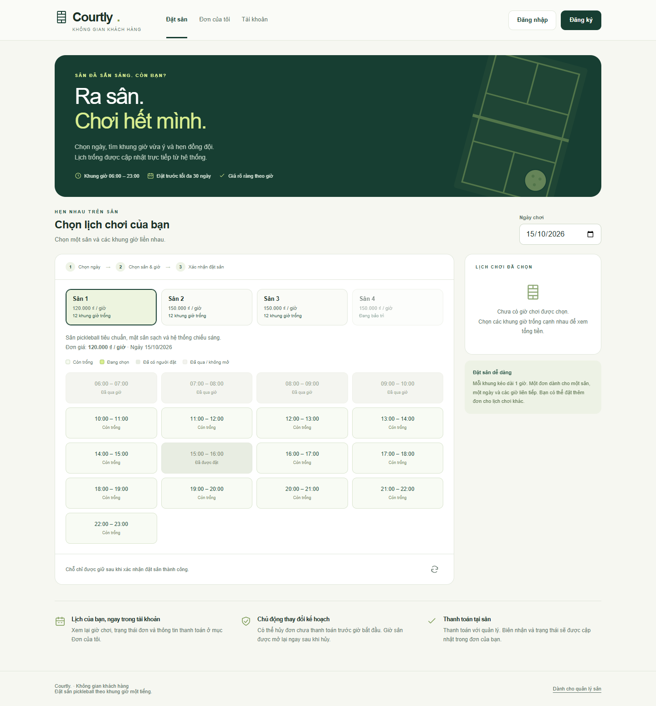
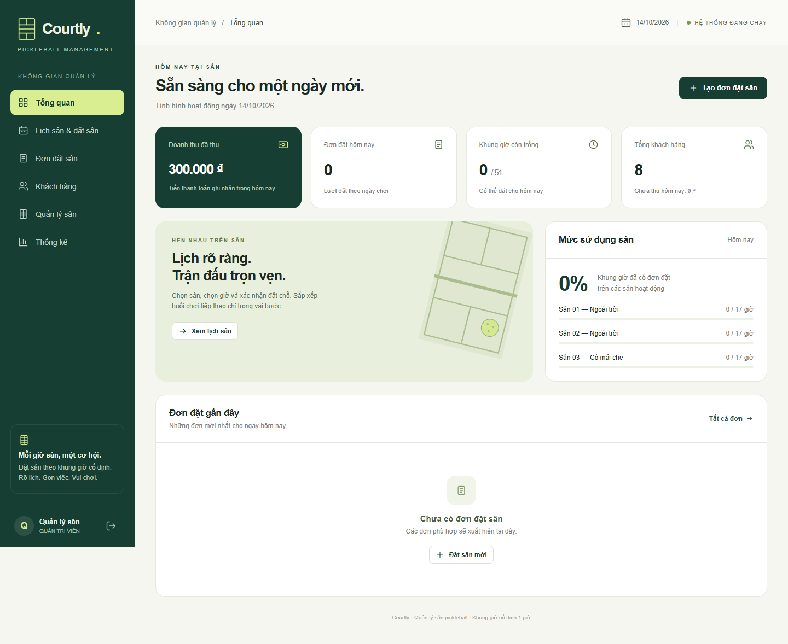

# BTL_DB — Courtly: Quản lý đặt sân pickleball

Bài tập lớn môn **Cơ sở dữ liệu** cho nhóm 5 thành viên: khách hàng tự đặt sân và nhân viên quản lý lịch, khách hàng, thanh toán, doanh thu.

Ứng dụng dùng **Java 17+, Spring Boot 3.5.16, JDBC và MySQL 8.0.16+**. Giao diện HTML/CSS/JavaScript được phục vụ bởi chính Java; không cần Node.js để chạy ứng dụng.

Repository gồm mã nguồn, SQL, ERD, dữ liệu mẫu, kiểm thử và hướng dẫn demo. Chưa có báo cáo học phần. Phần chuyển khoản hiện do quản lý xác nhận thủ công; QR và xác nhận giao dịch ngân hàng tự động chưa triển khai.

## Chuẩn bị trên máy mới

- **Windows** để dùng các file BAT và script chạy nhanh có sẵn.
- **JDK 17 trở lên**, gồm cả `java` và `javac`; đặt `JAVA_HOME` tới thư mục JDK nếu máy chưa nhận Java.
- **MySQL Server 8.0.16 trở lên**. Script mặc định tìm tại `C:\Program Files\MySQL\MySQL Server 8.0`. Nếu cài ở nơi khác, xem mục xử lý lỗi hoặc cách dùng MySQL có sẵn bên dưới.
- **Internet trong lần chạy đầu** để tải Maven và thư viện. Maven được tải tự động, không cần cài riêng.

MySQL Workbench chỉ cần khi muốn xem database bằng giao diện. Node.js và Playwright chỉ dùng cho kiểm thử trình duyệt, không phải điều kiện chạy web.

## Tải mã nguồn

Chọn **Code → Download ZIP** trên GitHub và giải nén, hoặc dùng Git:

```bash
git clone https://github.com/phungminhduc1656-creator/BTL_DB.git
cd BTL_DB
```

Mở thư mục vừa tải rồi làm theo hướng dẫn nhấp đúp bên dưới. Bản trên GitHub chứa mã nguồn và dữ liệu mẫu để tự khởi tạo; JAR, dữ liệu MySQL đang dùng, cache Maven và cấu hình riêng của mỗi máy không được đưa vào repository.

## Giao diện minh họa

Ảnh chụp từ các lần chạy demo/kiểm thử, dùng dữ liệu mẫu; ngày, giá và số liệu khi tự chạy có thể khác.

<details>
<summary>Phía khách hàng — chọn sân và khung giờ</summary>



</details>

<details>
<summary>Phía quản lý — tổng quan hoạt động</summary>



</details>

## Chạy bằng cách nhấp đúp, không cần gõ lệnh

Mở thư mục dự án trong File Explorer:

- Nhấp đúp **CHAY_UNG_DUNG.bat** để chạy. Chờ khởi động xong; trình duyệt sẽ tự mở đúng địa chỉ/cổng của ứng dụng.
- Mở **MO_KHACH_HANG.bat** để vào phía khách; đăng ký tài khoản mới để tự đặt sân.
- Mở **MO_QUAN_LY.bat** để vào phía quản lý; đăng nhập **admin / admin123**.
- Nhấp đúp **DUNG_UNG_DUNG.bat** để dừng cả Java và MySQL, giữ toàn bộ dữ liệu.

Các file BAT tự gọi `scripts/desktop.ps1` và các script PowerShell có sẵn; bạn không cần mở PowerShell hay nhập lệnh. Nếu có lỗi, cửa sổ sẽ giữ thông báo để xem. Khi ứng dụng đang chạy, nhấp lại file chạy sẽ mở ứng dụng hiện có.

Phần hướng dẫn bằng lệnh bên dưới dành cho khi cần tùy chỉnh hoặc kiểm thử.

## Khởi động bằng lệnh trên Windows

Sau khi cài JDK và MySQL Server, mở PowerShell tại thư mục dự án rồi chạy:

```powershell
powershell -ExecutionPolicy Bypass -File .\scripts\start.ps1
```

Mở **http://127.0.0.1:8080**, đăng nhập **admin / admin123**.

Lệnh trên sẽ:

1. Tạo một MySQL riêng ở `127.0.0.1:3307`, dữ liệu nằm trong `.local/mysql`. Không dùng hoặc sửa dữ liệu của MySQL khác trên cổng3306.
2. Tải Maven và thư viện vào `.tools` khi cần; lần đầu cần Internet.
3. Biên dịch Java, tạo bảng/khóa/trigger/procedure và dữ liệu tham chiếu.
4. Khi bảng đơn đặt còn trống, tạo lịch sử mẫu và lịch đặt từ ngày khởi tạo đến ba ngày sau. Chạy lại giữ dữ liệu đã có, không tạo thêm lịch mẫu mỗi ngày. Những ngày chưa có lịch mẫu vẫn đặt sân bình thường trong giới hạn 30 ngày.
5. Chạy web trên cổng8080 ở nền; có thể đóng cửa sổ terminal. Lệnh chờ khởi tạo xong rồi mới in đường dẫn.

Dừng Java và MySQL riêng, giữ toàn bộ dữ liệu:

```powershell
powershell -ExecutionPolicy Bypass -File .\scripts\stop.ps1 -All
```

Mật khẩu root của MySQL riêng được tạo ngẫu nhiên và lưu trong `.local/mysql-admin.cnf`; thư mục này được bỏ qua bởi Git. Các giá trị tài khoản ứng dụng trong cấu hình mẫu dành cho demo trên máy cá nhân.

Chỉ dừng Java để sửa code rồi chạy lại: `scripts/stop.ps1`. Nếu ứng dụng đã chạy, `start.ps1` trả lại địa chỉ hiện có thay vì mở thêm một bản hoặc ghi đè JAR đang được sử dụng. Nhật ký Java nằm trong `.local/logs/app.out.log` và `app.err.log`.

Nếu cổng8080 đang được sử dụng:

```powershell
powershell -ExecutionPolicy Bypass -File .\scripts\start.ps1 -Port 8082
```

## Hai trang riêng

- **Khách hàng:** `/khach-hang/` — xem sân trống, đăng ký/đăng nhập, đặt sân, xem/hủy đơn của mình, sửa hồ sơ, đổi mật khẩu.
- **Quản lý:** `/quan-ly/` — tổng quan, lịch sân, khách hàng, thu tiền và thống kê. Địa chỉ `/` vẫn mở phía quản lý.
- [Hướng dẫn phía khách và vị trí từng phần mã nguồn](docs/khach-hang.md). Hai phía dùng chung MySQL; dùng cửa sổ ẩn danh để đăng nhập hai vai trò cùng lúc.

## Mở toàn bộ CSDL trong MySQL Workbench

Nhấp đúp **MO_CSDL_MYSQL.bat** ở thư mục gốc. File này khởi động MySQL riêng của bài và mở Workbench với file truy vấn `database/XEM_TOAN_BO_DB.sql`.

Thông số kết nối:

- Host: `127.0.0.1`
- Port: `3307`
- Username: `pickleball_app`
- Password mặc định lúc cài mới: `pickleball_local_2026`; nếu đã đổi, dùng mật khẩu đang lưu trong User environment `DB_PASSWORD`.
- Database/default schema: `pickleball_db`

Trong Workbench, mở tab **Schemas**, nhấn nút làm mới nếu cần, rồi mở `pickleball_db → Tables`. Nhấp phải một bảng → **Select Rows - Limit 1000** để xem dữ liệu. File `XEM_TOAN_BO_DB.sql` có các câu SELECT xem cả 7 bảng, danh sách procedure/trigger và cấu trúc bảng đặt sân; chạy toàn bộ bằng Ctrl+Shift+Enter. File này chỉ đọc, không cần nhập lại schema hoặc seed.

Tài khoản MySQL ở trên khác với tài khoản web quản lý `admin / admin123`. Kết nối `Local instance MySQL80` cổng3306 và các kết nối khác trên máy không phải DB riêng của bài. Nếu đổi mật khẩu MySQL ứng dụng, dùng mật khẩu mới thay cho giá trị demo này.
## Chức năng quản lý

| Màn hình | Có thể làm |
|---|---|
| Tổng quan | Xem đơn theo ngày, tiền đã thu, khoản chưa thu, giờ sân trống và mức sử dụng sân. |
| Lịch sân & đặt sân | Chọn ngày, sân, một hoặc nhiều giờ liên tiếp; chọn hoặc thêm khách hàng rồi đặt. |
| Đơn đặt sân | Tìm theo mã/tên/điện thoại; lọc ngày/trạng thái; xem chi tiết, hủy, thu tiền, hoàn tất. |
| Khách hàng | Thêm, sửa, tìm kiếm và xem lịch sử đặt. |
| Quản lý sân | Thêm, sửa tên/giá/mô tả; đặt trạng thái hoạt động/bảo trì/ngừng hoạt động. |
| Thống kê | Chọn khoảng ngày; xem doanh thu, đơn, giờ thuê, phương thức thu tiền; tải CSV mở bằng Excel. |

Tất cả màn hình dùng dữ liệu thật từ MySQL. Dữ liệu mẫu có 4 sân, 8 khách hàng và 17 khung giờ từ06:00 đến23:00. Giao diện có bố cục cho máy tính và điện thoại, thông báo lỗi và xác nhận trước khi hủy đơn.

## Quy tắc nghiệp vụ quan trọng

- Tên đăng nhập khách hàng cho phép tiếng Việt, không để trống, tối đa50 ký tự và không trùng; bỏ khoảng trắng ở hai đầu.
- Mật khẩu đăng ký/đổi phải có ít nhất8 ký tự, một chữ hoa, một chữ số và một ký tự đặc biệt; tối đa72 byte UTF-8. Mật khẩu hiện có vẫn đăng nhập bình thường.


- Một ô đặt là **sân + ngày chơi + khung giờ một tiếng**. Chỉ một đơn chưa hủy được giữ ô đó.
- Một đơn có thể chọn nhiều giờ **liên tiếp**, trên cùng sân và ngày.
- Chỉ đặt từ hôm nay đến30 ngày tới; giờ đã bắt đầu và sân không hoạt động không nhận đặt.
- Đặt nhiều giờ là một giao dịch: nếu một giờ bị tranh chấp, cả đơn được rollback.
- Hủy giữ nguyên đơn/chi tiết để tra cứu, đồng thời giải phóng các ô giờ.
- Giá được chụp tại thời điểm đặt trong `booking_items.unit_price`; sửa giá sân không đổi đơn cũ.
- Ghi nhận thanh toán toàn bộ đơn một lần, bằng tiền mặt hoặc chuyển khoản. Quản lý xác nhận sau khi thực nhận đủ tiền. Chưa triển khai QR/VietQR, tự xác nhận giao dịch ngân hàng, đặt cọc hoặc hoàn tiền; đơn đã thu tiền không được hủy.
- Hoàn tất chỉ khi đã thu đủ tiền và khung giờ cuối đã kết thúc.
- Doanh thu tính theo **ngày thu tiền**; lượt đặt, khoản chưa thu và số giờ thuê tính theo **ngày chơi**. Đơn hủy không đóng góp doanh thu.

## Cấu trúc mã nguồn

```text
pom.xml                         Maven và các thư viện Java
src/main/java/vn/edu/pickleball/
  PickleballApplication.java     Điểm chạy ứng dụng
  ApiController.java            API nghiệp vụ
  BookingService.java           Xử lý nghiệp vụ và truy vấn
  Database.java                 JDBC, tham số SQL và gọi procedure
  customer/                     API, tài khoản, nghiệp vụ và DTO phía khách
  SessionAuth.java              Phiên đăng nhập dùng chung
  CustomerSchema.java           Migration DB cũ
  PortalPages.java              Đường dẫn khách hàng và quản lý
  AuthController.java           Đăng nhập/đăng ký/đăng xuất bằng phiên
  AuthFilter.java               Bảo vệ API, CSRF và header
  Requests.java                 DTO và kiểm tra đầu vào
  ApiErrors.java                Chuyển lỗi thành JSON tiếng Việt
  SqlInstaller.java             Đọc SQL có DELIMITER
  DemoData.java                 Khởi tạo tài khoản và dữ liệu giả
src/main/resources/static/      Giao diện quản lý
  khach-hang/                   Giao diện khách hàng riêng
database/                       Schema, routines, seed, truy vấn minh họa
src/test/java/                  Kiểm thử Java/MySQL
docs/                           ERD, quy tắc, API và kịch bản demo
scripts/                        Chạy, dừng và kiểm thử
```

JDBC được chọn để nhóm nhìn và giải thích trực tiếp SQL thay vì để ORM tự tạo schema. `Controller → Service → Database` tách phần HTTP, nghiệp vụ và truy cập dữ liệu. Stored procedure tự quản lý giao dịch; không bọc các `CALL` bằng một giao dịch Java khác.

## SQL và ERD

- [Giải thích database từ đầu cho người mới — từng bảng, khóa, procedure, trigger và SQL](docs/GIAI_THICH_DATABASE_TU_DAU.md)
- [ERD và giải thích các bảng](docs/erd.md)
- [Ảnh ERD PNG](docs/erd.png) và [SVG](docs/erd.svg)
- [Quy tắc nghiệp vụ](docs/business-rules.md)
- [API và dữ liệu trả về](docs/api.md)
- [Kịch bản trình bày cho 5 người](docs/demo-guide.md)
- [Kết quả kiểm tra bản hiện tại](docs/verification.md)

Trong MySQL Workbench, chọn database riêng `pickleball_db`, chạy lần lượt:

```text
database/01_schema.sql
database/02_routines.sql
database/03_seed.sql
database/05_customer_portal.sql
database/06_customer_account_rules.sql
```

`04_queries.sql` có12 ví dụ JOIN, GROUP BY, truy vấn con, CTE và thống kê. Các truy vấn này chỉ đọc dữ liệu.

Khóa chống trùng là `UNIQUE(court_id, play_date, time_slot_id, active_guard)`. `active_guard` bằng1 khi còn giữ chỗ và NULL khi đã giải phóng. MySQL cho phép nhiều NULL trong UNIQUE, nên lịch sử đơn hủy vẫn được giữ mà không cản đơn mới.

## Chạy trên máy thành viên khác

Cần JDK17 trở lên và MySQL Server8.0.16 trở lên. Mở dự án Maven bằng IntelliJ IDEA, Eclipse hoặc NetBeans; điểm chạy là `PickleballApplication`. Lần đầu chạy bằng IDE, đặt `APP_SETUP=true` và `APP_SEED=true` trong cấu hình Run; nếu đã nhập năm script SQL (01, 02, 03, 05, 06) bằng quản trị viên thì chỉ cần `APP_SEED=true`.

**Dùng MySQL đã có:** tạo database riêng, chạy năm script SQL (01, 02, 03, 05, 06) bằng tài khoản có quyền tạo bảng/trigger/procedure, đặt các biến môi trường sau trước khi chạy Java:

```powershell
$env:DB_URL='jdbc:mysql://127.0.0.1:3306/pickleball_db?connectionTimeZone=%2B07:00&forceConnectionTimeZoneToSession=true&useSSL=false&allowPublicKeyRetrieval=true'
$env:DB_USER='ten_tai_khoan_mysql'
$env:DB_PASSWORD='mat_khau_mysql'
powershell -ExecutionPolicy Bypass -File .\scripts\start.ps1 -ExistingDatabase -SchemaReady
```

`-ExistingDatabase` không khởi động MySQL riêng. `-SchemaReady` bỏ bước tạo bảng/routine/trigger vì đã nhập SQL; Java vẫn tạo tài khoản và lịch mẫu khi chưa có. Khi bật `app.setup=true`, Java cần quyền tạo lại routines/trigger trong đúng database. MySQL có binary log và báo lỗi1419 khi tạo trigger cần quản trị viên nhập SQL hoặc cấu hình máy chủ phát triển phù hợp; không cấp quyền SUPER cho tài khoản chạy web.

**Dùng Docker cho MySQL:**

```powershell
docker compose up -d
.\mvnw.cmd spring-boot:run '-Dspring-boot.run.arguments=--app.setup=true --app.seed=true'
```

Không chạy Docker và MySQL riêng của `start-mysql.ps1` cùng lúc trên cổng3307. Dữ liệu Docker được giữ trong volume `pickleball_mysql`.

Có thể đổi mật khẩu tài khoản demo trước lần khởi tạo đầu bằng `ADMIN_PASSWORD` (ít nhất8 ký tự). Chạy lại seeder không ghi đè mật khẩu hoặc thông tin đã sửa. `.env` được Docker Compose đọc; Java đọc biến môi trường của terminal, không tự đọc `.env`. Các script chạy/kiểm thử trên Windows còn đọc User environment `DB_PASSWORD` nếu terminal hiện tại chưa có biến này; mật khẩu đã đổi không cần ghi vào mã nguồn.

## Kiểm thử

Kiểm thử dùng **MySQL thật**, không dùng H2 hay mock thay thế DB. Có hai nhóm:

- 33 kiểm tra SQL: ràng buộc, giao dịch, trạng thái và các tình huống cạnh tranh.
- Kiểm thử tích hợp Java cho nghiệp vụ quản lý và khách hàng: tài khoản, quyền truy cập, chủ đơn, CSRF, hồ sơ và mật khẩu.

Chạy kiểm thử Java bằng database riêng, giữ dữ liệu demo:

```powershell
powershell -ExecutionPolicy Bypass -File .\scripts\test.ps1
```

Chạy cả33 kiểm tra SQL bằng PowerShell7:

```powershell
pwsh -File .\scripts\test.ps1 -IncludeSqlChecks
```

Các kiểm thử Java tạo dữ liệu độc lập trong `pickleball_integration_test`. Bộ kiểm tra SQL tạo database tạm có tên ngẫu nhiên rồi tự dọn database đó. Để tránh chạy nhầm khi chỉ build trên máy chưa có MySQL, `mvnw test` mặc định bỏ qua test tích hợp; chỉ bật khi `RUN_MYSQL_TESTS=true`. Xem kết quả Java tại `target/surefire-reports/`.

Kiểm thử trình duyệt dùng `scripts/browser-smoke.cjs` và `scripts/customer-browser-smoke.cjs`. Chỉ chạy trên một bản ứng dụng/database QA riêng vì các script tạo tài khoản, đơn và thanh toán mẫu; không trỏ vào DB chính.

Cần Node.js và Playwright cho công cụ QA. Tại thư mục dự án, cài công cụ trước:

```bash
npm install --no-save --package-lock=false playwright
npx playwright install chromium
```

Mặc định ảnh kiểm thử được lưu trong `.local/screenshots/`; ảnh phía khách nằm trong thư mục con `customer/`. Có thể đặt `QA_ARTIFACT_DIR` để đổi thư mục ảnh (đường dẫn tương đối tính từ gốc dự án), `PLAYWRIGHT_MODULE` để chỉ định module Playwright, và `PLAYWRIGHT_EXECUTABLE_PATH` để chọn trình duyệt (`CHROME_PATH` cũ vẫn được hỗ trợ).

Đóng gói mã nguồn cùng JAR để gửi thành viên khác: chạy `scripts/package.ps1`. ZIP nằm trong `.local/releases`, không chứa dữ liệu MySQL, mật khẩu root hay cache Maven. Người nhận có thể chạy `scripts/start.ps1 -SkipBuild` để dùng JAR đã biên dịch.

## Xử lý lỗi thường gặp

| Hiện tượng | Cách xử lý |
|---|---|
| Không thấy MySQL Server tại đường dẫn mặc định | Chạy `scripts/start-mysql.ps1 -MysqlBase 'đường dẫn thư mục MySQL Server'`, hoặc dùng Docker/MySQL đã có. |
| Không tìm được Java | Đặt `JAVA_HOME` về thư mục JDK chứa `bin/java` và `bin/javac`. |
| MySQL không khởi động | Đọc `.local/logs/mysql.log`, kiểm tra cổng3307 đang được chương trình nào sử dụng. |
| Không tải được thư viện lần đầu | Kiểm tra Internet và chạy lại `mvnw.cmd -U package`. |
| Trình duyệt báo phiên không hợp lệ | Tải lại trang và đăng nhập lại; token CSRF thay đổi khi đăng nhập/đăng xuất. |

Mặc định ứng dụng chỉ lắng nghe trên `127.0.0.1`. Bản hiện tại là ứng dụng quản lý dùng trong bài tập, đã có cổng khách tự đặt; chưa có nhiều chi nhánh, hội viên hay giải đấu.


Kiểm thử trình duyệt phía khách nằm ở `scripts/customer-browser-smoke.cjs`. Cần tạo DB QA riêng, chạy bản Java riêng trên8081 với `DB_URL` trỏ tới DB đó, rồi đặt `QA_URL=http://127.0.0.1:8081` trước khi gọi Node.js. Script bắt buộc URL QA và từ chối cổng8080; nó tạo tài khoản/đơn giả để thử desktop/mobile. Xem [kết quả kiểm tra](docs/verification.md).
