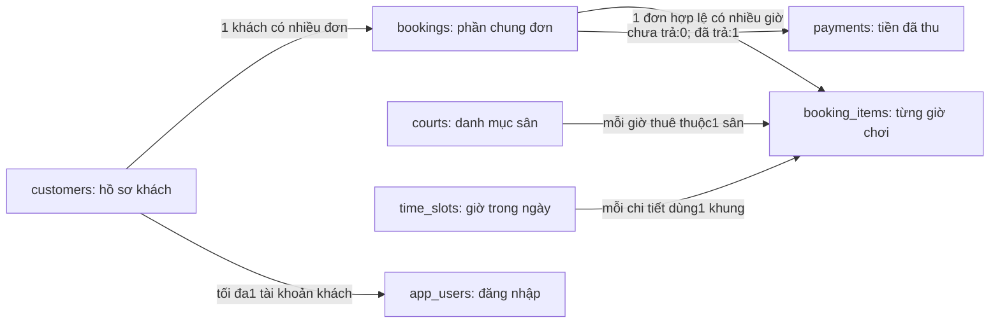

# Giải thích database pickleball từ đầu

Tài liệu tự học bám sát mã nguồn hiện tại của dự án Java/MySQL tại D:\BTL_DB. Các dòng dữ liệu mang ID 20, 7, 101, 501, 502 dưới đây là ví dụ tưởng tượng để giải thích, không khẳng định chúng có trong DB thật. Đọc theo thứ tự; không cần học thuộc câu lệnh trước khi hiểu chúng lưu việc gì.

## 1. Phân biệt các thứ đang dùng

- **MySQL Server** là chương trình lưu dữ liệu và xử lý SQL. MySQL riêng của bài nghe tại 127.0.0.1:3307; tệp dữ liệu thật nằm trong .local/mysql.
- **Database pickleball_db** là bộ dữ liệu của hệ thống, gồm bảng, ràng buộc, procedure và trigger.
- **MySQL Workbench** là công cụ để bạn kết nối tới MySQL, xem cấu trúc và chạy SQL. Đóng Workbench không xóa DB.
- **SQL** là ngôn ngữ hỏi và thay đổi dữ liệu, ví dụ SELECT để đọc.
- **Website** là phần khách/nhân viên nhìn thấy. Java nhận thao tác, kiểm tra quyền và dùng JDBC gửi SQL tới MySQL.
- **Các file database/*.sql** là mã định nghĩa/khởi tạo/truy vấn. Chúng không phải bản dữ liệu sống cập nhật sau mỗi lượt đặt; dữ liệu sống nằm trong MySQL.

Luồng thường gặp: người dùng nhấn Đặt sân → Java kiểm tra và lấy chủ đơn từ phiên → gọi procedure MySQL → MySQL ghi dữ liệu → Java trả kết quả → trang hiện đơn.

Trong Workbench, dùng pickleball_db. Các schema có qa/test là database phục vụ kiểm thử riêng. Trong schema, Tables chứa bảng; Stored Procedures chứa thủ tục. Bản này không tạo view hoặc stored function riêng. SUM, COUNT, NOW là hàm có sẵn của MySQL, không phải function do nhóm viết. Có 5 procedure nghiệp vụ và 9 trigger; các procedure hỗ trợ migration được xóa sau khi chạy.

## 2. Bảng, dòng, cột và ID

Hình dung bảng như một trang tính có cấu trúc. Bảng customers có cột id, full_name, phone, email. Một dòng là một hồ sơ khách; cột là một thông tin của hồ sơ.

| id | full_name | phone | email |
|---|---|---|---|
| 20 | Nguyễn Văn An | 0902000020 | an@example.com |

Dòng trên có nghĩa: khách mang ID 20 tên An, có số điện thoại và email được ghi. ID là mã định danh để các bảng nối đến đúng người. Hai người có thể trùng tên nên không dùng họ tên làm mã nối.

ID của các bảng độc lập: khách 20 không buộc có tài khoản 20 hoặc đơn 20. AUTO_INCREMENT tự cấp ID mới; ID có thể nhảy số sau thao tác thất bại/rollback, nên ID lớn nhất không phải số lượng bản ghi.

Đếm số khách bằng SELECT COUNT(*) FROM customers, không dùng MAX(id).

## 3. Tình huống dùng xuyên suốt

Giả sử An đăng ký tài khoản và đặt sân 1 vào 20/10/2026 từ 18:00 đến 20:00, giá 150.000 đ/giờ. Thông tin minh họa:

- customers.id = 20: hồ sơ An.
- app_users.id = 7, customer_id = 20: tài khoản đăng nhập của An.
- bookings.id = 101: đơn đặt của An.
- booking_items.id = 501 và 502: hai giờ riêng trong đơn 101.
- time_slots.id = 13: 18:00–19:00; id = 14: 19:00–20:00 theo seed hiện tại.
- Tổng tiền: 150000 + 150000 = 300000 đ.

Như vậy: 1 tài khoản liên kết 1 hồ sơ khách; 1 đơn đặt 2 giờ cần 1 dòng bookings và 2 dòng booking_items. Các ID 13/14 chỉ là ID danh mục; không phải quy tắc toán học rằng ID luôn suy ra được giờ.

## 4. Nhìn toàn bộ 7 bảng

| Bảng | Trả lời câu hỏi |
|---|---|
| customers | Người thuê sân là ai? |
| courts | Có những sân nào, giá hiện tại và trạng thái ra sao? |
| time_slots | Một ngày chia thành các khoảng giờ nào? |
| bookings | Đơn nào được tạo, của khách nào, trạng thái gì? |
| booking_items | Trong đơn có những sân/ngày/giờ nào, giá lúc đặt bao nhiêu? |
| payments | Đơn nào đã nhận tiền, số tiền và phương thức gì? |
| app_users | Ai có tài khoản đăng nhập web, thuộc vai trò nào? |

## 5. customers — hồ sơ người thuê

Mã nguồn: database/01_schema.sql, dòng 10.

| Cột | Kiểu và điều kiện | Ý nghĩa |
|---|---|---|
| id | BIGINT, PRIMARY KEY, AUTO_INCREMENT | Mã khách do DB tự cấp. |
| full_name | VARCHAR(100), NOT NULL | Họ tên; CHECK yêu cầu độ dài sau TRIM từ 2–100. |
| phone | VARCHAR(20), NOT NULL, UNIQUE | Điện thoại bắt buộc và không trùng hồ sơ khác. |
| email | VARCHAR(254), NULL | Có thể chưa cung cấp; nếu có thì DB không chấp nhận chuỗi trống/toàn dấu cách. |

Một khách đặt 10 đơn vẫn chỉ cần 1 hồ sơ customers. Các đơn lưu customer_id trỏ tới hồ sơ đó. Nếu số điện thoại khách đổi, sửa một hồ sơ thay vì sửa 10 đơn.

Điện thoại là VARCHAR vì cần giữ số 0 ở đầu và có thể có dấu +. Không dùng INT cho thông tin này. Email thiếu nên lưu NULL, không ghi chữ 'NULL'.

DB chỉ kiểm tra phone có 8–20 ký tự sau TRIM và duy nhất. Java kiểm tra chặt hơn: dạng số Việt Nam bắt đầu 0 hoặc +84. DB chỉ kiểm tra email NULL/không trống; định dạng email được Java kiểm tra. Độ dài email qua API hiện giới hạn 150, dù cột chứa tối đa 254.

Khách do quản lý nhập có thể chưa có tài khoản web. Vì thế có customers không đồng nghĩa có app_users. Đăng ký mới không tự nhận hồ sơ cũ bằng cách nhập trùng số điện thoại.

## 6. courts — danh mục sân

Mã nguồn: 01_schema.sql, dòng 22.

| Cột | Kiểu/điều kiện | Ý nghĩa |
|---|---|---|
| id | BIGINT, PK, tự tăng | ID nội bộ của sân. |
| code | VARCHAR(20), NOT NULL, UNIQUE | Mã dễ đọc như SAN-01. |
| name | VARCHAR(100), NOT NULL | Tên hiển thị, như Sân 01—Ngoài trời. |
| description | VARCHAR(500), NULL | Mô tả thêm, có thể bỏ trống. |
| hourly_price | DECIMAL(12, 0), NOT NULL, CHECK > 0 | Giá hiện tại cho 1 giờ, đơn vị đồng. |
| status | VARCHAR(16), DEFAULT ACTIVE, CHECK | Trạng thái sân. |

ACTIVE là hoạt động; MAINTENANCE là bảo trì; INACTIVE là ngừng nhận đặt. Procedure tạo đơn chỉ nhận sân ACTIVE.

id và code khác vai trò: ID để liên kết dữ liệu, code để người dùng nhìn/tra cứu. Đổi tên sân không cần thay ID hay sửa các chi tiết đã trỏ đến sân đó.

Java giới hạn giá từ 1.000 đến 10.000.000 đ/giờ; schema chỉ yêu cầu giá dương và vừa kiểu DECIMAL. Java còn ngăn chuyển sân sang bảo trì/ngừng hoạt động khi còn đơn CONFIRMED chưa kết thúc. Đây không phải CHECK hiện có trên bảng courts.

hourly_price là giá hiện tại. Đơn đặt trước đó dùng booking_items.unit_price, vì vậy tăng giá sân không làm tăng tiền đơn cũ. Tên sân trên đơn lại được JOIN từ danh mục hiện tại, nên sửa tên có thể đổi tên hiển thị ở lịch sử.

## 7. time_slots — danh mục 17 khung giờ

Mã nguồn: 01_schema.sql, dòng 38; dữ liệu tại 03_seed.sql.

| Cột | Kiểu/điều kiện | Ý nghĩa |
|---|---|---|
| id | BIGINT, PK, tự tăng | Mã khung giờ. |
| start_time | TIME, NOT NULL | Giờ bắt đầu, không kèm ngày. |
| end_time | TIME, NOT NULL | Giờ kết thúc, không kèm ngày. |

Danh mục hiện tại có 17 khoảng 1 giờ: 06:00–07:00, ..., 22:00–23:00. CHECK bắt buộc đúng 3600 giây, đầu/cuối tròn giờ và nằm trong 06:00–23:00. UNIQUE(start_time, end_time) ngăn lặp một khoảng giờ trong danh mục.

| ID trong seed | Bắt đầu | Kết thúc |
|---|---|---|
| 1 | 06:00 | 07:00 |
| 12 | 17:00 | 18:00 |
| 13 | 18:00 | 19:00 |
| 14 | 19:00 | 20:00 |
| 17 | 22:00 | 23:00 |

time_slots không lưu 'còn trống' hoặc 'đã đặt'. Một khung 18:00–19:00 dùng chung cho mọi sân, mọi ngày. Chỉ khi ghép court_id + play_date + time_slot_id mới xác định được một ô lịch cụ thể.

Không tạo thêm 17 dòng time_slots cho ngày mai. Ngày chơi nằm trong booking_items. Ngày không có đơn thì không có các dòng giữ chỗ tương ứng; Java vẫn có thể dựng lịch từ danh mục sân × khung giờ rồi đánh dấu trống/bận.

## 8. app_users — tài khoản đăng nhập website

Mã nguồn: 01_schema.sql, dòng 115; nghiệp vụ trong Java customer/CustomerAccounts.java và AuthController.java.

| Cột | Kiểu/điều kiện | Ý nghĩa |
|---|---|---|
| id | BIGINT, PK, tự tăng | Mã tài khoản đăng nhập. |
| username | VARCHAR(50), NOT NULL, UNIQUE | Tên đăng nhập. |
| password_hash | VARCHAR(255), NOT NULL | Giá trị băm BCrypt, không phải mật khẩu rõ. |
| display_name | VARCHAR(100), NOT NULL | Tên hiển thị sau đăng nhập. |
| role | VARCHAR(16), NOT NULL, DEFAULT ADMIN | ADMIN hoặc CUSTOMER. |
| customer_id | BIGINT, NULL, UNIQUE, FK | Hồ sơ khách của tài khoản CUSTOMER. |

CHECK yêu cầu ADMIN có customer_id = NULL, CUSTOMER có customer_id khác NULL. FK bảo đảm hồ sơ được liên kết thật sự tồn tại. UNIQUE(customer_id) ngăn 2 tài khoản cùng nhận 1 hồ sơ khách; nhiều ADMIN vẫn có customer_id = NULL được.

Ví dụ An: app_users.id = 7, username = 'An Pickleball', role = 'CUSTOMER', customer_id = 20. Đơn của An lưu customer_id = 20, không lưu app_users.id = 7.

Username được Java bỏ khoảng trắng hai đầu trước kiểm tra/lưu, cho tiếng Việt và khoảng trắng bên trong, không trống/tối đa 50/không trùng. CHECK dùng TRIM chỉ kiểm tra điều kiện; bản thân CHECK không sửa dữ liệu. Collation hiện tại không phân biệt hoa/thường và dấu khi so sánh chuỗi, nên một số tên nhìn khác vẫn bị coi trùng.

Mật khẩu mới phải đủ 8 ký tự, không vượt 72 byte UTF-8, có chữ hoa, chữ số và dấu câu/ký hiệu. Java thực hiện chính sách và tạo BCrypt. CHECK của password_hash chỉ kiểm tra độ dài >= 50, không tự xác nhận đúng BCrypt và không thực thi chính sách mật khẩu.

Khi đăng nhập, Java tìm tài khoản theo username rồi dùng BCrypt kiểm tra mật khẩu nhập với hash. Không giải mã hash để lấy lại mật khẩu gốc. Các phiên đăng nhập/CSRF nằm ở Java, không phải cột mới trong 7 bảng.

Tài khoản MySQL như pickleball_app là tài khoản kết nối server của Java/Workbench. Nó khác tài khoản ADMIN/CUSTOMER trong app_users. Một khách đăng ký web không làm MySQL tạo thêm một user server. Mặc định role ADMIN phục vụ tài khoản quản trị/cấu trúc cũ; luồng đăng ký công khai luôn gán CUSTOMER ở Java, không nhận quyền tùy ý từ trình duyệt.

## 9. bookings — phần chung của đơn

Mã nguồn: 01_schema.sql, dòng 52.

| Cột | Kiểu/điều kiện | Ý nghĩa |
|---|---|---|
| id | BIGINT, PK, tự tăng | ID nội bộ của đơn. |
| booking_code | VARCHAR(50), NOT NULL, UNIQUE | Mã để người dùng tra cứu; procedure tạo dạng PB- cộng UUID bỏ dấu gạch. |
| customer_id | BIGINT, NOT NULL, FK → customers.id | Chủ hồ sơ thuê sân. |
| status | VARCHAR(16), DEFAULT CONFIRMED, CHECK | CONFIRMED, CANCELLED hoặc COMPLETED. |
| note | VARCHAR(500), NULL | Ghi chú của đơn. |
| created_at | DATETIME, DEFAULT CURRENT_TIMESTAMP | Thời điểm tạo đơn. |
| cancelled_at | DATETIME, NULL | Thời điểm hủy; chỉ có khi trạng thái CANCELLED. |

Ví dụ minh họa:

| id | booking_code | customer_id | status | created_at | cancelled_at |
|---|---|---|---|---|---|
| 101 | PB-MA-MINH-HOA | 20 | CONFIRMED | 2026-10-15 10:00:00 | NULL |

Đọc thành lời: đơn 101 do khách 20 đặt, đã giữ lịch thành công, tạo lúc 10 giờ ngày 15/10, chưa hủy. Mã PB-MA-MINH-HOA là mã giả dễ đọc trong tài liệu; mã thật do procedure tạo dài hơn từ UUID.

Đơn này chưa nói thuê sân nào, ngày nào, mấy giờ. Những thông tin ấy nằm ở booking_items. created_at không phải ngày chơi.

CHECK trạng thái chỉ nhận 3 giá trị nói trên. CHECK thời điểm hủy bắt buộc CANCELLED có cancelled_at, còn trạng thái khác phải để NULL.

CONFIRMED nghĩa là đơn đã được xác nhận giữ chỗ, không có nghĩa đã thu tiền. Thu đủ tiền xong đơn vẫn CONFIRMED; chỉ khi đã hết giờ và quản lý thực hiện Hoàn tất mới chuyển COMPLETED. Đồng hồ qua giờ cuối không tự động đổi trạng thái.

## 10. booking_items — từng giờ chơi của đơn

Mã nguồn: 01_schema.sql, dòng 73. Đây là bảng trung tâm cho lịch sân và chống đặt trùng.

| Cột | Kiểu/điều kiện | Ý nghĩa |
|---|---|---|
| id | BIGINT, PK, tự tăng | Mã chi tiết riêng, không phải ID đơn. |
| booking_id | BIGINT, NOT NULL, FK → bookings.id | Chi tiết thuộc đơn nào. |
| court_id | BIGINT, NOT NULL, FK → courts.id | Thuê sân nào. |
| play_date | DATE, NOT NULL | Ngày chơi. |
| time_slot_id | BIGINT, NOT NULL, FK → time_slots.id | Thuê khung một giờ nào. |
| unit_price | DECIMAL(12, 0), NOT NULL, CHECK > 0 | Giá của đúng giờ đó tại lúc đặt. |
| released_at | DATETIME, NULL | Thời điểm giải phóng ô giờ do hủy. |
| active_guard | TINYINT, GENERATED STORED | MySQL tự tính 1 khi chưa giải phóng, NULL khi đã giải phóng. |

Hai dòng cho đơn 101:

| id | booking_id | court_id | play_date | time_slot_id | unit_price | released_at | active_guard |
|---|---|---|---|---|---|---|---|
| 501 | 101 | 1 | 2026-10-20 | 13 | 150000 | NULL | 1 |
| 502 | 101 | 1 | 2026-10-20 | 14 | 150000 | NULL | 1 |

Dòng 501 giữ sân 1 ngày 20/10 lúc 18:00–19:00. Dòng 502 giữ sân 1 cùng ngày lúc 19:00–20:00. Cả hai cùng booking_id 101 nên thuộc 1 đơn. Khách đặt 3 giờ thì có 3 dòng chi tiết, không phải 3 đơn.

Tổng tiền đơn được tính SUM(unit_price) = 300000. Số giờ là COUNT(*) = 2 vì mỗi chi tiết ứng với 1 giờ. Không có cột total_amount trong bookings để lưu lặp tổng này.

unit_price là giá chụp lúc đặt. Nếu ngày mai quản lý tăng courts.hourly_price từ 150000 lên 200000 thì hai chi tiết vẫn 150000; trigger không cho sửa lịch sử giá đó. Chỉ giá được chụp; tên người/sân trong giao diện được lấy từ hồ sơ/danh mục hiện tại.

### Hai khóa UNIQUE khác nhau

```sql
UNIQUE (court_id, play_date, time_slot_id, active_guard)
UNIQUE (booking_id, court_id, play_date, time_slot_id)
```

Khóa thứ nhất so sánh nhiều đơn với nhau: không cho hai chi tiết đang giữ cùng một ô sân/ngày/giờ. Khóa thứ hai kiểm tra ngay trong một đơn: không cho thêm lặp cùng sân/ngày/giờ vào chính đơn đó, kể cả khi chi tiết từng được giải phóng.

### Vì sao cần active_guard?

Công thức thật:

```sql
active_guard TINYINT GENERATED ALWAYS AS (
    IF(released_at IS NULL, 1, NULL)
) STORED
```

- released_at = NULL → chưa giải phóng → active_guard = 1.
- released_at có thời điểm → đã giải phóng → active_guard = NULL.
- Đây là cột DB tự tính và lưu; Java không nhập tay 0/1.

Khi đơn 101 còn giữ chỗ, khóa của dòng 501 là (1, 2026-10-20, 13, 1). Đơn 102 muốn giữ đúng ô ấy cũng tạo cùng khóa, bị UNIQUE từ chối.

Khi An hủy, chi tiết 501 được ghi released_at, guard tự thành NULL. Khóa lịch sử là (1, 2026-10-20, 13, NULL). Đơn mới được thêm (1, 2026-10-20, 13, 1), vì hai khóa này khác nhau. MySQL còn cho phép nhiều NULL trong UNIQUE nên nhiều lần đặt-rồi-hủy cùng ô vẫn giữ được lịch sử.

Nếu chỉ UNIQUE(sân, ngày, giờ) mà giữ dòng hủy thì người mới vẫn bị chặn; nếu xóa chi tiết hủy để lách khóa thì mất lịch sử. Guard giải quyết cả hai yêu cầu trong thiết kế hiện tại.

NULL không phải 0, không phải chuỗi rỗng và không phải chữ 'NULL'. Kiểm tra bằng IS NULL hoặc IS NOT NULL, không dùng = NULL.

COMPLETED vẫn giữ released_at = NULL, guard = 1 ở các giờ trong quá khứ để giữ lịch sử. Guard không có nghĩa 'đang chơi'; nó có nghĩa chưa giải phóng do hủy. Khách khác đặt cùng giờ trên ngày khác vẫn được vì ngày nằm trong khóa. Khác sân cũng được vì sân nằm trong khóa.

## 11. payments — khoản tiền thực nhận

Mã nguồn: 01_schema.sql, dòng 100.

| Cột | Kiểu/điều kiện | Ý nghĩa |
|---|---|---|
| id | BIGINT, PK, tự tăng | Mã giao dịch ghi nhận tiền. |
| booking_id | BIGINT, NOT NULL, FK, UNIQUE | Khoản tiền thuộc đơn nào; mỗi đơn tối đa 1 khoản. |
| amount | DECIMAL(12, 0), NOT NULL, CHECK > 0 | Tiền đã ghi nhận. |
| method | VARCHAR(16), NOT NULL, CHECK | CASH hoặc TRANSFER. |
| paid_at | DATETIME, DEFAULT CURRENT_TIMESTAMP | Thời điểm nhận/ghi tiền. |

Trước khi thu tiền đơn 101: payments không có dòng nào booking_id 101. Sau khi quản lý ghi nhận 300000 đ bằng chuyển khoản:

| id | booking_id | amount | method | paid_at |
|---|---|---|---|---|
| 81 | 101 | 300000 | TRANSFER | 2026-10-18 09:00:00 |

UNIQUE(booking_id) quan trọng: nếu chỉ có PK id thì người ta có thể thêm payment 81, 82 cùng đơn 101. Khóa duy nhất trên booking_id chặn thu lần hai cho cùng đơn.

Procedure tự tính tổng các chi tiết để lưu tiền; trigger còn kiểm tra amount bằng toàn bộ tổng hợp lệ. Không nhận một con số tùy ý từ trình duyệt. Hiện chưa có đặt cọc, trả nhiều lần hay hoàn tiền.

CASH là tiền mặt, TRANSFER là chuyển khoản do quản lý ghi nhận đã nhận. Ghi một dòng TRANSFER không làm ngân hàng chuyển tiền; bản này chưa tích hợp cổng thanh toán.

Có payment → truy vấn hiển thị PAID; chưa có → UNPAID. PAID/UNPAID là kết quả truy vấn chứ không phải giá trị bookings.status. Đơn hủy không có payment, nhưng không vì UNPAID mà còn phải thu tiền: báo cáo khoản chưa thu chỉ xét đơn CONFIRMED.

## 12. Quan hệ giữa các bảng



| Quan hệ | Giải thích chính xác |
|---|---|
| customers → bookings | Khách có 0 hoặc nhiều đơn; mỗi đơn thuộc đúng 1 khách. |
| bookings → booking_items | Schema cho 0 hoặc nhiều chi tiết; procedure bảo đảm đơn tạo thành công có 1–17 chi tiết. |
| courts → booking_items | Một sân xuất hiện ở nhiều chi tiết theo các ngày/giờ; mỗi chi tiết có 1 sân. |
| time_slots → booking_items | Khung giờ được tái dùng trên nhiều sân/ngày; mỗi chi tiết tham chiếu 1 khung. |
| bookings → payments | Một đơn có 0 hoặc 1 khoản thanh toán. |
| customers ↔ app_users | Hồ sơ có 0 hoặc 1 tài khoản; CUSTOMER có đúng 1 hồ sơ, ADMIN không gắn hồ sơ khách. |

Số lượng quan hệ được đọc cho cả hệ thống, không chỉ số dòng hiện có. Dù hiện một khách chỉ có 1 đơn, mô hình vẫn cho nhiều đơn.

## 13. Hai nhánh xử lý đơn 101

Nhánh sử dụng sân:

1. Khách 20 đặt → tạo bookings 101 và chi tiết 501/502; CONFIRMED, chưa có payment.
2. Quản lý nhận 300000 → thêm payment; đơn vẫn CONFIRMED, trạng thái thu tiền được hiển thị PAID.
3. Sau 20:00 ngày 20/10, quản lý nhấn Hoàn tất → procedure kiểm tra đã trả đủ và đã hết giờ → đổi COMPLETED.

Nhánh hủy là lựa chọn khác, không xảy ra sau bước đã thu tiền:

1. Đơn 101 đang CONFIRMED và chưa có payment.
2. Khách tự hủy trước 18:00 ngày 20/10, hoặc quản lý xử lý hủy theo quyền hiện tại.
3. Đơn đổi CANCELLED, cancelled_at được ghi.
4. Trigger tự điền released_at cho 501/502, guard thành NULL.
5. Hai chi tiết không bị xóa; người khác có thể đặt lại các giờ ấy nếu vẫn trong khoảng nhận đặt.

Không có luồng hợp lệ 'thu tiền → hủy → hoàn tất' trong bản này. Hủy và hoàn tất là trạng thái kết thúc. Muốn đổi lịch sau hủy, tạo đơn mới; không hồi sinh dòng đã hủy.

## 14. Các mốc thời gian phải phân biệt

| Mốc ví dụ | Cột | Dùng để hiểu |
|---|---|---|
| 15/10/2026, 10:00 | bookings.created_at | Khách tạo đơn khi nào. |
| 18/10/2026, 09:00 | payments.paid_at | Tiền được nhận/ghi nhận khi nào. |
| 20/10/2026 | booking_items.play_date | Khách chơi ngày nào. |
| 18:00–19:00 và 19:00–20:00 | time_slots.start_time/end_time | Khách chơi giờ nào trong ngày đó. |

Doanh thu 300000 của ví dụ tính vào 18/10, còn lượt đặt 1 và giờ thuê 2 tính vào 20/10. Vì thế một ngày có doanh thu nhưng không có lịch chơi vẫn bình thường.

DATE chỉ chứa ngày, TIME chỉ chứa giờ, DATETIME chứa ngày + giờ. DATETIME không tự mang nhãn múi giờ. Ứng dụng thống nhất giờ Việt Nam bằng cấu hình JDBC và SET time_zone = '+07:00' trong các procedure. Đặt múi giờ ở một cửa sổ Workbench không tự áp dụng cho mọi kết nối khác.

## 15. Đọc các từ khóa trong lệnh tạo bảng

Đây là một dòng thật trong schema:

```sql
id BIGINT NOT NULL AUTO_INCREMENT
```

Đọc từ trái qua phải: tên cột là id; BIGINT lưu số nguyên; NOT NULL bắt buộc có giá trị; AUTO_INCREMENT nhờ MySQL tự cấp số mới khi thêm dòng.

| Từ khóa/kiểu | Giải thích cho người mới | Ví dụ trong bài |
|---|---|---|
| BIGINT | Số nguyên có phạm vi lớn; dùng làm ID. | customer_id = 20 |
| VARCHAR(n) | Chuỗi có độ dài thay đổi, giới hạn n ký tự theo cột. | tên, điện thoại, mã sân |
| DECIMAL(12, 0) | Số chính xác, tổng 12 chữ số, không có phần thập phân. | 150000 đồng |
| DATE | Ngày, không chứa giờ. | 2026-10-20 |
| TIME | Giờ, không chứa ngày. | 18:00:00 |
| DATETIME | Cả ngày lẫn giờ. | 2026-10-15 10:00:00 |
| TINYINT | Kiểu số nguyên nhỏ. | guard tính ra 1 hoặc NULL |
| NOT NULL | Không được thiếu giá trị. | đơn phải có khách |
| NULL | Chưa có/không áp dụng; ý nghĩa tùy cột. | chưa hủy nên cancelled_at NULL |
| DEFAULT | Giá trị dùng khi INSERT không cung cấp cột ấy. | đơn mới mặc định CONFIRMED |
| AUTO_INCREMENT | Tự cấp ID; không cam kết liên tiếp. | đơn 101, sau đó có thể 103 |
| CONSTRAINT tên | Đặt tên cho một ràng buộc. | uq_payments_booking |

VARCHAR(100) không có nghĩa luôn chiếm chỗ cho đủ 100 chữ; đó là giới hạn độ dài. DECIMAL được chọn cho tiền để có giá trị chính xác, thay vì dùng FLOAT/DOUBLE vốn có biểu diễn gần đúng.

Dòng `ENGINE=InnoDB` chọn bộ máy lưu trữ hỗ trợ transaction, khóa dòng và khóa ngoại. `CHARSET=utf8mb4` hỗ trợ tiếng Việt và các ký tự Unicode như emoji. `COLLATE=utf8mb4_0900_ai_ci` quy định cách so sánh/sắp xếp chuỗi: ai không phân biệt dấu, ci không phân biệt hoa/thường. Ví dụ tên đăng nhập An/AN bị coi là trùng.

## 16. PRIMARY KEY, FOREIGN KEY, UNIQUE và CHECK khác nhau thế nào?

### PRIMARY KEY — khóa chính

```sql
PRIMARY KEY (id)
```

Mỗi bảng cần một cách định danh chính xác một dòng. Khóa chính không được NULL hoặc trùng. Hai khách cùng tên vẫn có hai ID khác nhau. Cùng số 20 có thể xuất hiện làm ID ở bảng khác vì mỗi bảng là một không gian ID riêng.

### FOREIGN KEY — khóa ngoại

```sql
FOREIGN KEY (customer_id) REFERENCES customers (id)
```

Nghĩa là giá trị customer_id của một đơn phải trỏ đến id có thật trong customers. Nếu customers chỉ có khách 20, tạo đơn trỏ đến khách 999999 chưa tồn tại sẽ bị từ chối. Khóa ngoại không tự sao chép họ tên khách vào đơn; truy vấn JOIN mới nối dữ liệu để hiển thị.

Trong bài, các FK dùng `ON UPDATE RESTRICT ON DELETE RESTRICT`. Nếu hồ sơ khách còn được đơn hoặc tài khoản tham chiếu, MySQL chặn xóa hồ sơ hay đổi ID của hồ sơ đó. Điều này không cấm sửa số điện thoại/họ tên bình thường, vì đó không phải ID đang được FK tham chiếu. Không có xóa dây chuyền CASCADE ở các quan hệ này.

### UNIQUE — khóa duy nhất

UNIQUE có thể áp dụng một cột hoặc một tổ hợp. `UNIQUE(phone)` chặn hai hồ sơ cùng điện thoại; `UNIQUE(booking_id)` ở payments chặn thu hai lần; UNIQUE bốn cột trong booking_items chặn hai người giữ cùng ô sân/ngày/giờ.

Một bảng có một PRIMARY KEY và có thể có nhiều UNIQUE. PRIMARY KEY cũng định danh duy nhất nhưng không cho NULL; UNIQUE của MySQL có thể cho nhiều dòng chứa NULL. Cơ chế đó được sử dụng có chủ đích ở active_guard và app_users.customer_id.

### CHECK — kiểm tra giá trị

```sql
CHECK (hourly_price > 0)
CHECK (status IN ('ACTIVE', 'MAINTENANCE', 'INACTIVE'))
```

CHECK là điều kiện dữ liệu phải thỏa. Giá âm hoặc trạng thái gõ sai sẽ bị từ chối. TRIM bỏ dấu cách đầu/cuối của chuỗi trong biểu thức, CHAR_LENGTH đếm ký tự; nhưng CHECK kiểm tra chứ không tự sửa chuỗi được lưu.

CHECK chủ yếu kiểm tra điều kiện của dòng đang ghi trong thiết kế này. Các quy tắc cần nhìn sang nhiều dòng/bảng, như tổng tiền hay giờ đã bị chiếm, còn được xử lý bằng UNIQUE, procedure hoặc trigger phù hợp.

## 17. INDEX — vì sao có thêm các dòng tạo chỉ mục?

Index giống mục lục giúp MySQL tìm dòng theo khóa tìm kiếm. Nó không phải bảng nghiệp vụ mới và không tạo thêm đơn. Có index không có nghĩa mọi truy vấn luôn dùng index; MySQL còn xét độ chọn lọc và kích thước dữ liệu. Đổi lại index tốn lưu trữ và công cập nhật khi ghi.

| Index trong schema | Nhóm truy vấn có thể được hỗ trợ |
|---|---|
| courts(status) | Lọc sân đang hoạt động. |
| bookings(customer_id, created_at) | Lịch sử các đơn của một khách theo thời gian tạo. |
| bookings(status, created_at) | Lọc đơn theo trạng thái/thời gian. |
| booking_items(play_date, released_at) | Lịch của một ngày và các chi tiết chưa giải phóng. |
| booking_items(booking_id) | Tìm các giờ trong một đơn. |
| payments(paid_at) | Tra doanh thu theo khoảng thời gian nhận tiền. |

PRIMARY KEY và UNIQUE cũng tạo chỉ mục tương ứng. Khi nói 'có khóa' cần phân biệt mục đích ràng buộc đúng dữ liệu với tác dụng hỗ trợ tìm kiếm của chỉ mục.

## 18. Transaction — một đơn phải được lưu trọn vẹn

Một lượt đặt 18:00–20:00 cần ít nhất ba dòng mới: một header bookings và hai dòng booking_items. Nếu giờ 19:00–20:00 vừa bị người khác đặt, không thể báo thất bại mà vẫn để lại header hoặc giữ riêng giờ 18:00–19:00.

Transaction gom các thay đổi liên quan thành một đơn vị:

```sql
START TRANSACTION;
-- tạo header và toàn bộ chi tiết
COMMIT;
```

Nếu có lỗi trước khi hoàn tất, handler gọi `ROLLBACK` để hoàn tác những thay đổi chưa commit của giao dịch đó. COMMIT là xác nhận toàn bộ; ROLLBACK là rút lại toàn bộ phần đang làm. ID tự tăng có thể đã được cấp rồi bỏ qua sau rollback; không vì thiếu số mà kết luận mất một đơn.

Hai người cùng thấy sân trống vẫn có thể bấm đặt gần đồng thời. Giao diện chỉ phản ánh lúc nó vừa đọc; không thể bảo đảm không có ai khác bấm trước vài mili giây.

Procedure tạo đơn khóa dòng sân bằng `SELECT ... FOR UPDATE`, giữ đến cuối transaction, để đọc giá/trạng thái và tạo lịch nhất quán. Khóa này có thể khiến cả lượt đặt khác ngày trên cùng sân phải chờ ngắn; nó không chỉ khóa một ô giờ. Sau đó UNIQUE ở chi tiết là hàng rào chống trùng. Giao dịch thua cuộc bị rollback và người dùng được yêu cầu chọn lại.

Hủy, thu tiền và hoàn tất đều khóa dòng đơn trước để tránh vừa hủy vừa thu tiền cùng đơn. Không nên diễn đạt rằng dùng khóa thì tuyệt đối không có lỗi cạnh tranh/deadlock; hệ thống vẫn có thể trả lỗi và rollback để người dùng thử lại.

## 19. Procedure — hàm nghiệp vụ được lưu trong MySQL

Nếu đã học Java, có thể hình dung procedure tương tự một hàm có tham số được chạy bởi MySQL. Java chủ động gọi nó bằng CALL. Procedure không tự chạy chỉ vì đồng hồ sang ngày mới.

| Procedure thường trực | Dữ liệu đầu vào | Kết quả nghiệp vụ |
|---|---|---|
| sp_create_booking | khách, sân, ngày, mảng ID giờ, ghi chú | Tạo một đơn cùng các chi tiết và trả ID đơn. |
| sp_cancel_booking | ID đơn | Quản lý hủy đơn CONFIRMED chưa thu tiền. |
| sp_cancel_customer_booking | ID đơn, ID khách từ phiên Java | Khách hủy đơn đúng chủ, chưa thu tiền, chưa bắt đầu. |
| sp_pay_booking | ID đơn, CASH/TRANSFER | Tính đúng tổng tiền và ghi một payment. |
| sp_complete_booking | ID đơn | Chuyển COMPLETED khi đã trả đủ và hết giờ. |

Bốn procedure ở 02_routines.sql; procedure hủy của khách ở 05_customer_portal.sql. Các lệnh CALL sau là minh họa thao tác ghi, không thuộc phần truy vấn chỉ đọc để bạn thực hành phía dưới:

```sql
-- Ví dụ giả định khách20 tồn tại, ngày và các giờ vẫn được nhận đặt.
CALL sp_create_booking(20, 1, '2026-10-20', JSON_ARRAY(13,14), 'Đặt hai giờ');
```

`p_` trong tên biến là quy ước cho tham số đầu vào, `v_` là biến làm việc bên trong. JSON_ARRAY(13, 14) tương ứng danh sách [13, 14]. Thủ tục nhận danh sách, nhưng trong bảng chi tiết vẫn ghi thành hai dòng riêng, không nhét chuỗi '13, 14' vào một cột.

### Đọc sp_create_booking theo thứ tự

1. Bắt đầu transaction và chuẩn bị handler hoàn tác khi có lỗi.
2. Kiểm tra danh sách giờ là mảng JSON, có 1–17 ID nguyên dương.
3. Khóa sân; lấy giá/trạng thái, kiểm tra sân tồn tại và ACTIVE.
4. Kiểm tra hồ sơ khách tồn tại, giữ khóa chia sẻ khi tạo đơn.
5. JSON_TABLE biến danh sách ID thành các dòng để JOIN với time_slots. Đếm số ID khớp và DISTINCT để từ chối ID không tồn tại hoặc lặp.
6. Lấy giờ bắt đầu nhỏ nhất/giờ kết thúc lớn nhất. Vì từng slot đều một giờ, độ dài khoảng phải bằng số slot × 3600 giây. [13, 14] liên tiếp; [13, 15] có lỗ trống nên bị từ chối.
7. Lấy giờ thực tế sau khi chờ khóa; ngày phải từ hiện tại đến hiện tại + 30 và giờ đầu chưa được bắt đầu. Các mốc ngày tính theo giờ Việt Nam.
8. Tạo bookings với mã PB-UUID, lấy LAST_INSERT_ID của chính kết nối đó.
9. Tạo toàn bộ booking_items, cùng sân/ngày được truyền vào và cùng giá sân vừa đọc.
10. Nếu trùng một ô, lỗi 1062 được bắt, ROLLBACK cả đơn. Nếu thành công, COMMIT rồi SELECT ID đơn trả về Java.

Như vậy một sân/ngày và các giờ liên tiếp được luồng tạo đơn bảo đảm. Chỉ xem định nghĩa bảng thôi chưa thấy hết các quy tắc đó.

### Các thủ tục còn lại

sp_cancel_booking không kiểm tra giờ bắt đầu trong bản quản lý hiện tại; nó kiểm tra tồn tại, CONFIRMED và chưa thu tiền. sp_cancel_customer_booking còn đối chiếu chủ đơn và bắt đầu slot đầu tiên phải ở tương lai. Thủ tục chỉ đối chiếu ID khách được truyền; việc biết ai thật sự đang đăng nhập là trách nhiệm session/Java.

sp_pay_booking nhận phương thức chứ không nhận con số tiền tùy ý. Nó cộng các unit_price chưa giải phóng, từ chối đơn rỗng/đã trả, rồi thêm đúng một payment. sp_complete_booking kiểm tra payment bằng tổng chi tiết và slot cuối đã kết thúc mới đổi trạng thái.

Các procedure này tự quản lý transaction; Java không bọc CALL của chúng trong một transaction mới. Đăng ký/sửa hồ sơ/đổi mật khẩu là các luồng khác dùng @Transactional ở Java.

## 20. Trigger — quy tắc tự chạy khi một bảng bị ghi

Procedure do Java/chương trình gọi chủ động. Trigger tự chạy khi có INSERT, UPDATE hoặc DELETE trên bảng gắn với nó. BEFORE nghĩa là chạy trước thao tác; AFTER chạy sau thao tác của dòng trong cùng giao dịch. FOR EACH ROW nghĩa là kiểm tra từng dòng liên quan. NEW là dữ liệu mới; OLD là dữ liệu cũ trước khi sửa/xóa.

| Trigger | Tác dụng thực tế |
|---|---|
| trg_bookings_before_insert | Chỉ chấp nhận đơn mới CONFIRMED, chưa có thời điểm hủy. |
| trg_bookings_before_update | Giữ ID/mã/chủ đơn/ngày tạo; bảo vệ chuyển trạng thái, kiểm tra chưa trả khi hủy, trả đủ và hết giờ khi hoàn tất; bảo vệ thời điểm hủy. |
| trg_bookings_after_cancel | Khi đơn chuyển CANCELLED, tự điền released_at vào các chi tiết đang giữ chỗ. |
| trg_booking_items_before_insert | Đơn phải tồn tại, CONFIRMED, chưa thanh toán; chi tiết mới không được đánh dấu đã giải phóng. |
| trg_booking_items_before_update | Không sửa sân/ngày/giờ/giá/đơn; chỉ giải phóng lần đầu khi đơn đã hủy. |
| trg_booking_items_before_delete | Chặn xóa chi tiết lịch sử. |
| trg_payments_before_insert | Đơn tồn tại, CONFIRMED; số tiền phải bằng tổng chi tiết hợp lệ và lớn hơn 0. |
| trg_payments_before_update | Chặn sửa khoản tiền đã ghi nhận. |
| trg_payments_before_delete | Chặn xóa khoản tiền đã ghi nhận. |

Ví dụ dây chuyền hủy: procedure UPDATE bookings → trigger kiểm tra được hủy → trigger AFTER UPDATE sửa released_at của chi tiết → trigger chi tiết kiểm tra giải phóng hợp lệ → MySQL tự tính guard = NULL → COMMIT toàn bộ.

Không phải toàn bộ header bị cấm sửa: note không nằm trong nhóm định danh bất biến. Không có trigger DELETE riêng trên bookings; đơn có chi tiết/payment bị FK ngăn xóa. Header rỗng không được tham chiếu vẫn có thể bị xóa bằng SQL trực tiếp.

## 21. Các từ trong mã procedure/trigger

- DECLARE: khai báo biến/handler để dùng trong khối BEGIN...END.
- SELECT...INTO: đọc kết quả vào biến.
- IF...THEN...END IF: rẽ nhánh kiểm tra điều kiện.
- WHILE: lặp để kiểm tra từng ID trong danh sách.
- SIGNAL SQLSTATE '45000': chủ động báo lỗi nghiệp vụ, như BOOKING_CONFLICT.
- EXIT HANDLER: khi gặp nhóm lỗi, chạy phần xử lý rồi rời khối; trong bài thường ROLLBACK và báo lỗi ra ngoài.
- RESIGNAL: chuyển tiếp lỗi sau khi đã xử lý hoàn tác.
- COALESCE(a, b): lấy giá trị đầu tiên không NULL; SUM không có dữ liệu có thể NULL nên hay dùng COALESCE(SUM(...), 0).
- NULLIF(a, ''): trả NULL nếu a là chuỗi rỗng; dùng khi chuẩn hóa ghi chú.
- `<=>`: so sánh có xử lý NULL của MySQL; dùng để phát hiện thay đổi released_at/cancelled_at.
- SYSDATE(): thời điểm thực khi được gọi; procedure dùng sau khi chờ khóa để không kiểm tra bằng giờ cũ.

DELIMITER $$ là chỉ dẫn cho công cụ đọc file SQL, để dấu '; ' trong BEGIN...END không kết thúc cả CREATE PROCEDURE quá sớm. Kết thúc khối dùng END$$ rồi đổi lại DELIMITER ; . Java JDBC không gửi lệnh DELIMITER tới server; SqlInstaller tách file thành các statement trước khi thực thi.

## 22. Cái gì lưu thật, cái gì chỉ tính để hiển thị?

Màn hình có nhiều trường hơn số cột trong bảng vì Java dùng SELECT, JOIN và tổng hợp để tạo câu trả lời.

| Trường bạn thấy trên web | Nguồn |
|---|---|
| total_amount | SUM(unit_price) của chi tiết; không phải cột bookings. |
| slot_count | Đếm số chi tiết; mỗi chi tiết một giờ. |
| customer_name/customer_phone | JOIN hồ sơ customers hiện tại. |
| court_name | JOIN courts hiện tại. |
| start_time/end_time của cả đơn | MIN giờ bắt đầu/MAX giờ kết thúc từ các slot. |
| payment_status | Có dòng payments thì PAID, chưa có thì UNPAID. |
| can_cancel | Java tính theo trạng thái, thanh toán và giờ đầu; API kiểm tra chủ đơn trước khi trả dữ liệu. |
| available/reason | Java ghép lịch đã giữ, trạng thái sân và thời gian hiện tại. |
| active_guard | Ngoại lệ cần nhớ: là cột generated STORED thật trong booking_items, DB tự tính. |

Tên gọi AS trong SELECT chỉ là nhãn cột kết quả, không tự thêm cột vào bảng. Ví dụ SUM(unit_price) AS total_amount không sửa schema.

## 23. Mỗi file trong thư mục database làm gì?

| File/thư mục | Vai trò | Có dùng để xem dữ liệu hằng ngày không? |
|---|---|---|
| 01_schema.sql | Tạo 7 bảng, kiểu dữ liệu, PK/FK/UNIQUE/CHECK/index. | Đây là bản thiết kế; không cần chạy lại chỉ để xem bảng. |
| 02_routines.sql | Cài 4 procedure và 9 trigger nghiệp vụ. | Định nghĩa xử lý; web gọi procedure khi thao tác. |
| 03_seed.sql | Dữ liệu giả ban đầu: 8 khách, 4 sân, 17 khung giờ. | Phục vụ khởi tạo/demo. |
| 04_queries.sql | 12 truy vấn minh họa đọc dữ liệu, JOIN và thống kê. | Có thể đọc và chạy từng SELECT để học. |
| 05_customer_portal.sql | Bổ sung role/customer_id/ràng buộc vào DB cũ; cài procedure khách hủy. | Migration nâng cấp, không phải tạo lại toàn bộ dữ liệu. |
| 06_customer_account_rules.sql | Nới CHECK username cũ tối thiểu 3 thành 1–50 sau TRIM. | Migration thay quy tắc, không đổi tên/mật khẩu tài khoản. |
| XEM_TOAN_BO_DB.sql | SELECT xem các bảng, routine/trigger và cấu trúc. | File xem nhanh. |
| tests/verify-mysql.ps 1 | Tạo DB tạm để kiểm tra SQL, ràng buộc và tranh chấp. | Công cụ kiểm thử, không phải một bảng dữ liệu. |

Khi cài thủ công lần đầu trên DB đã được tạo/chọn, thứ tự là 01 → 02 → 03 → 05 → 06. File 04 và file XEM không phải migration bắt buộc. Tài khoản admin được Java tạo với BCrypt; 03_seed.sql không chứa mật khẩu đăng nhập rõ và cũng không tạo đơn.

CREATE TABLE IF NOT EXISTS không tự sửa bảng cũ. Vì vậy chỉ thêm cột vào file 01 rồi chạy lại chưa chắc làm DB đang có nhận cột đó; 05/06 mới làm nhiệm vụ nâng cấp. Các helper migration kiểm tra metadata information_schema, chỉ thêm/thay phần còn thiếu rồi tự bị DROP. Xóa helper không xóa bảng hoặc đơn.

02 dùng DROP TRIGGER/PROCEDURE IF EXISTS để thay định nghĩa xử lý, không dùng DROP DATABASE/TABLE. DDL nâng cấp có cơ chế commit riêng của MySQL; không suy ra rằng cả file migration tự rollback như transaction đặt sân.

## 24. Dữ liệu mẫu có tự thay đổi mỗi ngày không?

DemoData.java có điều kiện: chỉ khi bật seed và COUNT(*) của bookings bằng 0 mới tạo lịch mẫu. Nó tạo lịch sử 14 ngày trước và một số lịch từ ngày tạo demo đến 3 ngày sau, bỏ các giờ trong ngày đã bắt đầu; có đơn đã thu, chưa thu và đã hủy để dễ trình bày.

Những ngày đó được lưu thành DATE thật trong booking_items. Sang ngày mới không tự dịch các đơn sang ngày mới, không tự sinh thêm đơn và không xóa lịch cũ. Một lần tạo demo ngày 14/10 không có nghĩa đến ngày 16/10 hệ thống tự tạo lại lịch ngày 16–19/10.

Bạn chọn ngày 20/10 thì truy vấn lấy booking_items có play_date = '2026-10-20'. Đổi sang 21/10 thì truy vấn đổi điều kiện ngày. Nếu chưa có người đặt, không có dòng giữ chỗ cho ngày đó; lịch vẫn dựng được từ courts và time_slots. Khách/người quản lý có thể tạo đơn thật bằng ứng dụng cho ngày hợp lệ, không bị giới hạn chỉ các ngày có demo.

Seeder có thể tạo lịch sử bằng SQL riêng để phục vụ minh họa, nên có đơn trong quá khứ không có nghĩa khách trên web được đặt ngược ngày.

## 25. Đọc 12 truy vấn trong 04_queries.sql

| Số | Câu hỏi được giải quyết | Kiến thức sử dụng |
|---|---|---|
| 1 | Khách có tên chứa Minh hoặc số điện thoại khớp chuỗi tìm là ai? | SELECT, WHERE, LIKE, ORDER BY. |
| 2 | Sân ACTIVE và giá thuê hiện tại? | WHERE và sắp xếp. |
| 3 | Ngày mai mỗi sân hoạt động có những slot trống/bận nào? | CROSS JOIN sân × slot, LEFT JOIN chi tiết chưa giải phóng. |
| 4 | Một đơn có khách/sân/ngày/giờ/giá và khoản thu nào? | JOIN nhiều bảng, LEFT JOIN payments. |
| 5 | Mỗi đơn có mấy giờ, tổng tiền bao nhiêu, đã trả chưa? | Truy vấn con tổng hợp theo booking_id. |
| 6 | Khách nào có ít nhất 2 đơn chưa hủy? | GROUP BY, HAVING COUNT >= 2. |
| 7 | Mỗi ngày nhận bao nhiêu tiền trong 30 ngày gần đây? | SUM trên payments theo DATE(paid_at). |
| 8 | Mỗi sân được đặt mấy giờ trong 30 ngày, giá trị các giờ đó? | LEFT JOIN, COUNT, SUM, COALESCE. |
| 9 | Tối đa 5 khách có tổng chi tiêu đã trả cao nhất? | WITH/CTE, JOIN, GROUP BY, LIMIT. |
| 10 | Đơn nào đã trả đủ, hết giờ và có thể hoàn tất? | MAX giờ kết thúc, HAVING; chỉ đọc, không tự đổi trạng thái. |
| 11 | Khách nào chưa từng có bất kỳ đơn nào? | NOT EXISTS. |
| 12 | Hôm nay mỗi sân hoạt động đã được giữ bao nhiêu trên 17 giờ mở cửa? | CTE, COUNT, tỷ lệ phần trăm. |

Query 3 trong file hỏi ngày mai bằng CURRENT_DATE + INTERVAL 1 DAY; không tự hỏi ngày 20/10 của ví dụ. Muốn xem ngày cụ thể thì thay điều kiện ngày.

Query 8 gọi booked_value là giá trị giờ đã đặt, không phải doanh thu đã thu. Query 12 dùng mẫu số 17 slot/ngày, không phải số slot tương lai còn lại ở thời điểm đang xem. Lịch hôm nay có thể loại slot đã qua khi cho khách chọn nhưng mẫu số tỷ lệ theo cả ngày vẫn 17.

### JOIN nối bảng bằng ID

```sql
SELECT b.booking_code, c.full_name
FROM bookings b
JOIN customers c ON c.id = b.customer_id;
```

b và c là tên viết tắt do người viết đặt. ON chỉ cách khớp: customer_id của đơn phải bằng id của hồ sơ. Kết quả trả mã đơn và tên người đặt, dù tên không lưu trong bookings.

INNER JOIN/JOIN chỉ giữ những dòng khớp cả hai bên. LEFT JOIN giữ cả dòng bên trái khi bên phải chưa có, nên vẫn thấy đơn chưa thanh toán khi nối payments; cột payment ở dòng đó sẽ NULL.

CROSS JOIN ghép mỗi sân với mỗi khung. 4 sân × 17 khung sinh 68 dòng kết quả, không INSERT 68 dòng vào DB. Lọc chỉ 3 sân ACTIVE thì còn 51 ô kết quả cho một ngày trước khi xét đã qua giờ/bị giữ.

### COUNT, SUM, GROUP BY và HAVING

COUNT(*) đếm dòng; SUM(unit_price) cộng tiền; GROUP BY booking_id gom các chi tiết cùng đơn để tính riêng từng tổng. MIN/MAX lấy giá trị nhỏ/lớn nhất.

Nếu một đơn có hai chi tiết: COUNT(*) = 2 là số giờ, không phải số đơn. Đếm số đơn trong tập chi tiết dùng COUNT(DISTINCT booking_id). WHERE lọc từng dòng trước khi nhóm; HAVING lọc các nhóm sau tổng hợp.

WITH đặt tên cho kết quả trung gian trong một câu truy vấn. CTE không tự tạo thêm bảng nghiệp vụ. Các tên totals, occupied, capacity trong truy vấn có thể là alias/CTE, không phải bảng mới xuất hiện trong Tables.

### Lỗi nhân đôi doanh thu khi JOIN

Payment 81 có amount 300000; đơn 101 có hai chi tiết 501/502. JOIN payment với cả hai chi tiết tạo:

| payment_id | booking_item_id | amount |
|---|---|---|
| 81 | 501 | 300000 |
| 81 | 502 | 300000 |

Nếu SUM(amount) ngay trên tập này sẽ ra 600000 dù chỉ thực nhận 300000. Vì thế query 7 cộng trực tiếp từ payments, hoặc cần tổng hợp đúng đơn vị trước khi JOIN.

SUM(DISTINCT amount) không phải cách sửa chung: hai đơn khác nhau cùng trả 300000 sẽ bị gộp nhầm thành một giá trị. Khi làm thống kê, trước hết xác định mỗi dòng trong tập đang đại diện một đơn, một giờ hay một khoản thu.

## 26. Phần SQL chỉ đọc để tự đối chiếu trong Workbench

Các câu trong vùng dưới không tạo/sửa/xóa dữ liệu. Mỗi lần đặt con trỏ trong một câu SELECT rồi Ctrl+Enter. Nếu bảng không có dòng khớp, kết quả rỗng là hợp lệ.

<!-- BEGIN_READONLY_EXERCISES -->

```sql
USE pickleball_db;
```

Chọn database đang đọc, tương tự mở đúng thư mục làm việc:

```sql
SHOW TABLES;
DESCRIBE customers;
```

SHOW TABLES liệt kê bảng. DESCRIBE cho xem tên cột, kiểu, NULL, khóa và mặc định của một bảng.

```sql
SELECT id, full_name, phone, email
FROM customers
ORDER BY id;
```

SELECT chọn cột, FROM chọn bảng, ORDER BY sắp xếp. SQL không cam kết thứ tự các dòng nếu không có ORDER BY.

```sql
SELECT id, start_time, end_time
FROM time_slots
ORDER BY start_time;
```

Dùng kết quả này đối chiếu ID giờ. Không đoán ID từ giờ đồng hồ.

```sql
SELECT b.id, b.booking_code, c.full_name, b.status, b.created_at
FROM bookings b
JOIN customers c ON c.id = b.customer_id
ORDER BY b.id DESC
LIMIT 10;
```

DESC là giảm dần; LIMIT 10 chỉ xem 10 đơn đầu trong thứ tự này. Đây là một ví dụ JOIN đơn với người đặt.

```sql
SELECT bi.booking_id, c.name AS court_name, bi.play_date,
       t.start_time, t.end_time, bi.unit_price, bi.released_at
FROM booking_items bi
JOIN courts c ON c.id = bi.court_id
JOIN time_slots t ON t.id = bi.time_slot_id
WHERE bi.booking_id = (SELECT MIN(id) FROM bookings)
ORDER BY bi.play_date, t.start_time;
```

Câu này lấy đơn có ID nhỏ nhất đang tồn tại để bạn khỏi phải đoán ID 101 của ví dụ. Một đơn nhiều giờ sẽ có nhiều dòng kết quả.

```sql
SELECT booking_id, COUNT(*) AS so_gio, SUM(unit_price) AS tong_tien
FROM booking_items
GROUP BY booking_id
ORDER BY booking_id;
```

Đây là cách từ nhiều chi tiết suy ra số giờ và tiền của từng đơn. Bao gồm cả lịch sử đơn hủy để bạn xem; nếu tính doanh thu thì phải đọc payments.

```sql
SELECT b.id, b.booking_code, b.status,
       CASE WHEN p.id IS NULL THEN 'UNPAID' ELSE 'PAID' END AS payment_status,
       p.amount, p.method, p.paid_at
FROM bookings b
LEFT JOIN payments p ON p.booking_id = b.id
ORDER BY b.id;
```

Thấy CONFIRMED đi cùng PAID là đúng thiết kế. UNPAID trên dòng CANCELLED không có nghĩa vẫn đòi thu tiền đơn ấy.

```sql
SELECT DATE(paid_at) AS ngay_thu, COUNT(*) AS so_don_da_thu,
       SUM(amount) AS doanh_thu
FROM payments
GROUP BY DATE(paid_at)
ORDER BY ngay_thu;
```

Tổng hợp trực tiếp payments nên mỗi khoản thu được cộng một lần.

```sql
SELECT court_id, play_date, time_slot_id, COUNT(*) AS so_dong_giu_cho
FROM booking_items
WHERE released_at IS NULL
GROUP BY court_id, play_date, time_slot_id
HAVING COUNT(*) > 1;
```

Bình thường truy vấn cuối không trả dòng nào: không có hai chi tiết cùng giữ một ô. Kết quả rỗng ở câu này là điều mong đợi.

<!-- END_READONLY_EXERCISES -->

## 27. Java và MySQL chia trách nhiệm ra sao?

| Quy tắc | Phần thực hiện chính hiện tại |
|---|---|
| ID, tham chiếu tồn tại, không trùng điện thoại/tên đăng nhập/mã sân | PK, FK, UNIQUE trong schema. |
| Giá dương, trạng thái hợp lệ, slot 1 giờ, role/hồ sơ khớp | CHECK trong schema. |
| Một đơn có các giờ liên tiếp, trong 30 ngày, giờ tương lai, cùng sân/ngày | sp_create_booking. |
| Hủy/thu tiền/hoàn tất nguyên vẹn và tuần tự với cùng đơn | Procedure, transaction và khóa. |
| Chặn sửa chi tiết/giá lịch sử, thanh toán đã ghi | Trigger và FK. |
| Kiểm tra định dạng điện thoại/email, giá từ 1000–10 triệu | Java DTO/service. |
| Mật khẩu mạnh, BCrypt, đăng ký tạo hồ sơ và tài khoản đồng thời | CustomerAccounts và @Transactional. |
| Khách đăng nhập là ai, được truy cập API nào | SessionAuth/AuthFilter và controller. |
| Không lộ thông tin người khác trên lịch công khai | API khách lọc dữ liệu trả về. |
| Tổng tiền, số giờ, doanh thu, trạng thái thanh toán để hiển thị | SQL tổng hợp và Java. |

Database.java dùng JDBC và câu SQL có tham số '? '. Java truyền giá trị riêng vào PreparedStatement thay vì nối trực tiếp chuỗi nhập vào SQL. Việc này giúp tránh biến nội dung nhập thành câu lệnh SQL.

Ví dụ đăng ký: Java kiểm tra thông tin → INSERT customers → lấy ID hồ sơ → INSERT app_users với role CUSTOMER/customer_id vừa tạo → commit. Nếu trùng tên/số điện thoại hoặc lỗi ở bước sau, transaction Java rollback để không để lại hồ sơ mồ côi.

Ví dụ đặt: trình duyệt gửi sân/ngày/giờ; Java lấy customer_id từ phiên, không tin một ID chủ đơn do người dùng tự gõ → gọi procedure tạo đơn → trả lại chi tiết đã JOIN/tổng hợp. Phiên và CSRF không được lưu trong 7 bảng này.

Nếu tự INSERT bằng Workbench, bạn không đi qua các kiểm tra Java hoặc tự nhiên được procedure kiểm tra hộ. Chẳng hạn schema còn cho tạo header rỗng, chi tiết khác sân/ngày hoặc giá dương tự nhập; procedure của app mới áp quy tắc tạo đơn đầy đủ. SQL trực tiếp là quyền dành cho người quản lý DB, không phải cách khách dùng web.

## 28. Vì sao chia nhiều bảng? Có phải cứ chia 7 bảng là chuẩn hóa không?

Nếu nhét tất cả vào một bảng, mỗi giờ An chơi phải lặp tên/điện thoại/tên sân. Sửa số điện thoại có thể phải sửa nhiều dòng; chỉ thêm khách chưa đặt thì khó biết phải điền những cột đơn nào. Tách hồ sơ, danh mục, đơn và chi tiết giúp dữ liệu có nơi quản lý rõ ràng, giảm lặp các thuộc tính của thực thể.

Tuy nhiên, số bảng không chứng minh mô hình đạt một dạng chuẩn cụ thể. Trong thiết kế hiện tại, một đơn theo nghiệp vụ dùng một sân/ngày nhưng court_id/play_date vẫn nằm trong mỗi chi tiết để đặt trực tiếp UNIQUE chống trùng sân-ngày-giờ ở đó. Nếu phân tích 3NF chặt theo phụ thuộc hàm booking_id → court_id, play_date, cần nêu rõ quyết định và cân nhắc thiết kế thay thế; không khẳng định 'mọi bảng đạt 3NF' chỉ vì đã có PK/FK.

Giá lịch sử unit_price được lưu có chủ đích: nó là giá đã chốt của lần thuê, không phải bản sao cần luôn cập nhật giống giá hiện tại của sân.

## 29. Tự kiểm tra mức hiểu bằng ví dụ

1. Một khách đặt ba giờ liền nhau: thêm bao nhiêu dòng đơn, bao nhiêu dòng chi tiết? Đáp án: 1 bookings, 3 booking_items; chưa thu tiền thì 0 payments.
2. Khách đặt hôm nay để chơi ngày mai: created_at và play_date có bằng nhau không? Không bắt buộc, vì hai sự kiện khác nhau.
3. Sửa giá sân, đơn cũ tăng tiền không? Không; đơn cũ có unit_price riêng.
4. Một đơn đã trả tiền có thể còn CONFIRMED không? Có; cần hết giờ và thực hiện hoàn tất mới COMPLETED.
5. Hủy có xóa chi tiết không? Không; released_at có thời điểm và guard thành NULL.
6. Sân 1, ngày 20/10, 18–19 và sân 2 cùng ngày/giờ có xung đột không? Không, khác sân.
7. Sân 1 lúc 18–19 ngày 20/10 và 21/10 có xung đột không? Không, khác ngày.
8. Hai dòng cùng sân/ngày/giờ và guard 1 có được không? Không, UNIQUE chặn.
9. Khách có ID 20, tài khoản ID 7 thì đơn lưu customer_id nào? 20.
10. Chỉ biết bookings.status có biết đã thu tiền chưa? Chưa; cần xem payments.
11. Một payment 300000 JOIN hai chi tiết rồi SUM amount được bao nhiêu? 600000, nên phải sửa cách tổng hợp.
12. Sang ngày mới hệ thống tự thêm khách/đơn mẫu không? Không; seed chỉ chạy khi bật cờ và bookings đang rỗng.

Khi bạn có thể tự chỉ vào từng ô ở hai bảng bookings/booking_items và kể được câu chuyện của đơn 101, bạn đã có nền để học phần khóa, JOIN và procedure còn lại.
