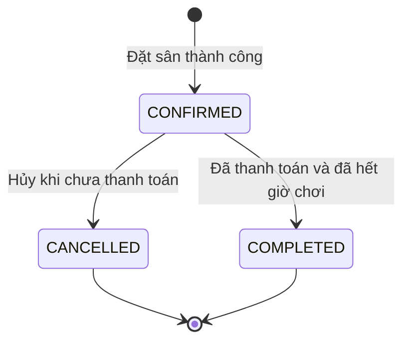

# Quy tắc nghiệp vụ

Tài liệu này mô tả hành vi của bản demo dành cho bài tập cơ sở dữ liệu: nhân viên quản lý một cơ sở pickleball, đặt sân cho khách và ghi nhận thanh toán.

## Phạm vi

- Một cơ sở có nhiều sân; nhân viên đăng nhập để sử dụng hệ thống.
- Khách hàng được quản lý bằng họ tên, số điện thoại và email tùy chọn.
- Một đơn đặt dành cho một khách, một sân, một ngày và một hoặc nhiều giờ liên tiếp.
- Mỗi giờ chơi là một khung giờ cố định. Lịch mở cửa là 06:00–23:00.
- Ghi nhận thanh toán tiền mặt hoặc chuyển khoản; hệ thống không kết nối ngân hàng hay cổng thanh toán.
- Đơn thanh toán đủ tiền một lần. Tiền cọc, trả nhiều lần, hoàn tiền, giải đấu và nhiều chi nhánh nằm ngoài phạm vi bản demo.

## Sân và khách hàng

1. Mã sân là duy nhất. Giá thuê tính theo một giờ và phải là số tiền hợp lệ.
2. Sân có ba trạng thái: `ACTIVE` (hoạt động), `MAINTENANCE` (bảo trì), `INACTIVE` (ngừng hoạt động).
3. Chỉ sân `ACTIVE` được nhận đơn đặt mới. Không được chuyển sân sang bảo trì hoặc ngừng hoạt động nếu sân còn đơn `CONFIRMED` giữ ô giờ chưa kết thúc; cần xử lý các đơn đó trước. Đổi trạng thái sân không tự động hủy đơn.
4. Số điện thoại khách hàng là duy nhất. Khi khách quay lại, chọn bản ghi hiện có thay vì tạo bản ghi trùng số điện thoại.
5. Đổi giá sân chỉ tác động đến các đơn tạo sau thời điểm đổi. Chi tiết của đơn cũ lưu giá đã chốt khi đặt.

## Đặt sân

1. Ngày chơi dùng múi giờ Việt Nam `Asia/Ho_Chi_Minh`, UTC+07:00.
2. Nhận đặt từ ngày hiện tại đến ngày hiện tại cộng 30 ngày, gồm cả hai mốc. API cấu hình trả hai ngày này để giao diện sử dụng cùng giới hạn với máy chủ.
3. Chỉ đặt những khung giờ chưa bắt đầu. Nếu đặt cho hôm nay, các ô đã đến giờ bắt đầu không nhận đơn mới.
4. Nhân viên chọn sân, ngày chơi và các khung giờ trong danh mục. Không nhập khoảng giờ tùy ý như 18:20–19:40.
5. Các khung giờ trong một đơn phải liên tiếp và không được lặp. Ví dụ 18:00–19:00 cùng 19:00–20:00 là hợp lệ; 18:00–19:00 cùng 20:00–21:00 không hợp lệ.
6. Mỗi tổ hợp `court_id + play_date + time_slot_id` chỉ có một chi tiết còn giữ chỗ (`released_at IS NULL`).
7. Tạo đơn và toàn bộ chi tiết trong cùng một giao dịch. Nếu một ô giờ không còn trống, không lưu một phần đơn.
8. Sau khi tạo thành công, đơn có trạng thái `CONFIRMED`. Trạng thái này có nghĩa lịch đã được giữ; trạng thái thanh toán được xác định riêng từ bảng `payments`.
9. Máy chủ đọc giá từ dữ liệu sân và lưu `unit_price` vào chi tiết. Giao diện không quyết định giá thanh toán.

Hai người cùng thấy một ô giờ trống vẫn có thể cùng bấm đặt. Cơ sở dữ liệu phải từ chối yêu cầu xung đột bằng khóa duy nhất; giao diện cần tải lại lịch sau khi nhận lỗi.

## Hủy đơn

1. Chỉ hủy đơn `CONFIRMED` chưa có thanh toán.
2. Khi hủy, đổi trạng thái thành `CANCELLED`, ghi `cancelled_at` và điền `released_at` cho toàn bộ chi tiết trong cùng một giao dịch.
3. Sau khi hủy thành công, các ô giờ của đơn được đặt lại nếu vẫn nằm trong khoảng ngày cho phép.
4. Giữ nguyên đơn và chi tiết để tra cứu lịch sử. Không xóa bản ghi thanh toán hay đơn cũ để giải phóng sân.
5. Đơn đã thanh toán không được hủy trong bản demo vì quy trình hoàn tiền chưa được triển khai.

## Thanh toán và hoàn tất

1. Chỉ ghi nhận thanh toán cho đơn `CONFIRMED` chưa thanh toán.
2. Mỗi đơn có tối đa một bản ghi `payments`; khóa duy nhất của `booking_id` bảo vệ quy tắc này.
3. Phương thức hợp lệ là `CASH` (tiền mặt) hoặc `TRANSFER` (chuyển khoản).
4. Máy chủ tính số tiền bằng tổng `unit_price` trong đơn; nhân viên chỉ chọn phương thức thanh toán.
5. Thanh toán thành công chưa tự động chuyển đơn thành `COMPLETED`.
6. Chỉ hoàn tất đơn đã thanh toán khi thời gian kết thúc của khung giờ cuối đã qua. Đơn chuyển từ `CONFIRMED` sang `COMPLETED`.
7. Đơn `CANCELLED` không được thanh toán hoặc hoàn tất. Đơn `COMPLETED` không được hủy hoặc thanh toán lại.

Việc thanh toán là một thông tin của đơn, không phải một trạng thái thứ tư. Một đơn `CONFIRMED` có thể đã hoặc chưa thanh toán.

## Báo cáo và bảo vệ dữ liệu

- Doanh thu đã thu được tính từ `payments.amount`, theo thời điểm ghi nhận thanh toán `paid_at`.
- Số lượt đặt, số giờ thuê, số đơn hủy và tiền chưa thu được tính theo ngày chơi `play_date`. Chỉ tiêu lượt đặt và giờ thuê loại trừ đơn đã hủy.
- Ví dụ thu tiền hôm nay cho lịch ngày mai: doanh thu tăng ở hôm nay, lượt đặt tăng ở ngày mai. Vì thế báo cáo theo một ngày có thể có doanh thu dù không có lượt chơi trong ngày đó.
- Báo cáo mặc định hiển thị 30 ngày gần nhất; có thể chọn khoảng tối đa 93 ngày, gồm cả ngày đầu và ngày cuối.
- Các thao tác ghi dữ liệu yêu cầu phiên đăng nhập hợp lệ và mã CSRF. Tài khoản mẫu chỉ dùng để chạy demo.
- Các thao tác đặt, hủy, thanh toán và hoàn tất phải kiểm tra lại dữ liệu tại máy chủ; nút bị vô hiệu hóa ở giao diện chỉ giúp người dùng thao tác đúng.
- Giao diện hỗ trợ thêm và sửa sân/khách hàng, không cung cấp thao tác xóa lịch sử.

## Quy tắc được triển khai ở đâu?

Ứng dụng kiểm tra dữ liệu đầu vào, xác thực phiên và chuyển lỗi nghiệp vụ thành thông báo tiếng Việt. Các luồng quan trọng gọi procedure trong MySQL; procedure tự bắt đầu giao dịch, khóa dữ liệu cần thiết, lưu hoặc hoàn tác toàn bộ thao tác.

| Thành phần MySQL | Vai trò |
|---|---|
| `sp_create_booking` | Kiểm tra sân, khách, ngày, giờ liên tiếp và tương lai; lưu đơn cùng chi tiết; hoàn tác nếu một ô bị trùng. |
| `sp_cancel_booking` | Khóa đơn, từ chối đơn đã thanh toán rồi chuyển trạng thái hủy. |
| `sp_pay_booking` | Khóa đơn, kiểm tra chưa thanh toán và ghi nhận đúng tổng tiền. |
| `sp_complete_booking` | Kiểm tra đã trả đủ tiền và đã hết giờ chơi trước khi hoàn tất. |
| `trg_bookings_before_update` | Bảo vệ chuyển trạng thái, ngăn hủy đơn đã thanh toán và hoàn tất quá sớm. |
| `trg_bookings_after_cancel` | Tự ghi `released_at` cho chi tiết khi đơn được hủy. |
| `trg_payments_before_insert` | Bảo vệ quy tắc số tiền thanh toán phải bằng tổng tiền đơn. |
| Trigger bảo vệ lịch sử | Ngăn sửa giá/ô giờ của chi tiết và ngăn sửa hoặc xóa thanh toán đã ghi nhận. |

Khóa ngoại, khóa duy nhất, kiểu dữ liệu và `CHECK` là các lớp bảo vệ bổ sung. Xem [01_schema.sql](../database/01_schema.sql) và [02_routines.sql](../database/02_routines.sql) để đối chiếu mã nguồn.

## Quyền khách hàng

Trang `/khach-hang/` là phía khách tự phục vụ, `/quan-ly/` là phía quản lý. Khách chỉ truy cập hồ sơ và đơn của mình; danh tính lấy từ phiên trên máy chủ. Đăng ký tạo mới đồng thời hồ sơ và tài khoản, rollback toàn bộ nếu trùng tên đăng nhập/số điện thoại. Không gắn tự động tài khoản vào hồ sơ mẫu có sẵn.

Khách chỉ tự hủy đơn CONFIRMED, chưa thu tiền và trước giờ bắt đầu đầu tiên. Procedure `sp_cancel_customer_booking` kiểm tra chủ đơn và điều kiện trong cùng transaction có khóa. Thu tiền và hủy cạnh tranh chỉ một thao tác hợp lệ được hoàn thành. Đơn đã hủy vẫn giữ lịch sử, giải phóng các slot.

Lịch công khai không lộ mã đơn hay dữ liệu cá nhân. Khách xem trạng thái thu tiền; chỉ quản lý ghi nhận CASH/TRANSFER sau khi thực nhận. Đổi mật khẩu yêu cầu mật khẩu cũ và thu hồi các phiên đăng nhập khác.
