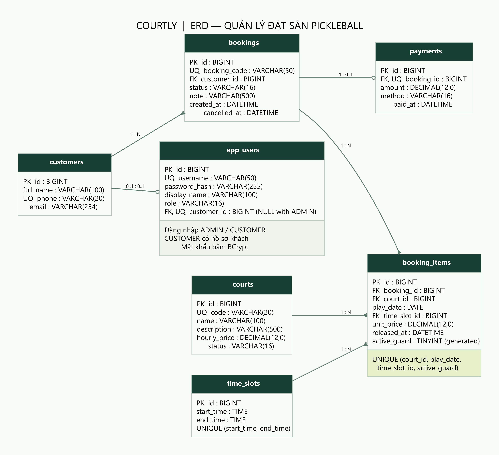
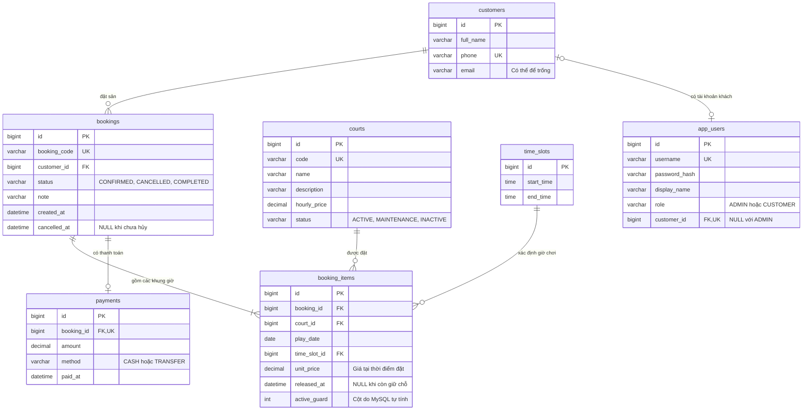

# Mô hình dữ liệu hệ thống đặt sân pickleball

Hệ thống quản lý một cơ sở có nhiều sân. Khách đặt một sân trong một ngày và chọn một hoặc nhiều khung giờ liên tiếp, mỗi khung dài một giờ. Dữ liệu được lưu trong MySQL 8.

[Ảnh ERD PNG](erd.png) · [ERD SVG để phóng to/in](erd.svg) · [Nguồn Graphviz](erd.dot)





`app_users` phục vụ đăng nhập quản trị và khách hàng; `customers` lưu hồ sơ người thuê sân. Tài khoản `ADMIN` không gắn khách hàng (`customer_id IS NULL`); tài khoản `CUSTOMER` bắt buộc gắn đúng một hồ sơ khách hàng. Một hồ sơ có tối đa một tài khoản, nhưng khách được nhân viên nhập tại quầy có thể chưa có tài khoản.

## Ý nghĩa các quan hệ

| Quan hệ | Ý nghĩa |
|---|---|
| Khách hàng → đơn đặt | Một khách có thể có nhiều đơn; mỗi đơn thuộc một khách. |
| Đơn đặt → chi tiết | Mỗi đơn hợp lệ có ít nhất một chi tiết, tương ứng một ô giờ được đặt. |
| Sân → chi tiết | Một sân có nhiều lượt đặt ở những ngày hoặc giờ khác nhau. |
| Khung giờ → chi tiết | Một khung giờ, ví dụ 18:00–19:00, được tái sử dụng cho nhiều sân và nhiều ngày. |
| Đơn đặt → thanh toán | Một đơn có tối đa một khoản thanh toán đủ tiền; đơn chưa thanh toán chưa có bản ghi này. |
| Khách hàng ↔ tài khoản | Một hồ sơ khách có tối đa một tài khoản `CUSTOMER`; quản trị không gắn hồ sơ khách. |

Trong MySQL, khóa ngoại bảo vệ quan hệ giữa các bản ghi. Procedure `sp_create_booking` kiểm tra quy tắc “mỗi đơn có ít nhất một chi tiết” và “các chi tiết thuộc cùng sân, cùng ngày, có giờ liên tiếp”, rồi tạo đơn trong một giao dịch.

## Chống đặt trùng bằng ràng buộc dữ liệu

MySQL tạo giá trị `active_guard` từ `released_at`:

```sql
active_guard TINYINT GENERATED ALWAYS AS (
    IF(released_at IS NULL, 1, NULL)
) STORED,
UNIQUE KEY uq_booking_items_active (
    court_id, play_date, time_slot_id, active_guard
)
```

Khi một chi tiết còn giữ chỗ, `active_guard = 1`. Khóa duy nhất ngăn hai bản ghi cùng giữ một tổ hợp **sân + ngày + khung giờ**. Ví dụ, sân A ngày 20/10 lúc 18:00–19:00 chỉ có một lượt giữ chỗ.

Khi hủy đơn chưa thanh toán, hệ thống ghi thời điểm vào `released_at`, khiến `active_guard = NULL`. MySQL cho phép nhiều giá trị `NULL` trong khóa duy nhất, nên đơn cũ vẫn được lưu để xem lịch sử và người khác có thể đặt lại ô giờ vừa giải phóng. Bản ghi `COMPLETED` giữ nguyên các chi tiết để bảo toàn lịch sử sử dụng sân.

Ràng buộc duy nhất là lớp bảo vệ cuối cùng khi hai yêu cầu đặt cùng ô giờ đến đồng thời. Việc kiểm tra lịch còn trống ở giao diện không thay thế được ràng buộc này.

## Một số quyết định thiết kế

- Danh mục có 17 khung giờ, từ 06:00–07:00 đến 22:00–23:00. Khách chọn ô giờ có sẵn.
- `unit_price` lưu giá tại thời điểm đặt. Khi giá sân thay đổi, tiền của các đơn cũ không thay đổi.
- Tổng tiền đơn là tổng `unit_price` của các chi tiết; tiền thanh toán phải bằng tổng này.
- Không xóa đơn khi hủy; chuyển trạng thái và giải phóng các ô giờ trong cùng giao dịch.
- Không lưu mật khẩu ở dạng văn bản; `password_hash` chứa giá trị băm BCrypt.
- `app_users.role` phân biệt `ADMIN` và `CUSTOMER`; CHECK `ck_app_users_role_customer` ngăn tài khoản sai cặp vai trò/hồ sơ. UNIQUE và FK trên `customer_id` bảo vệ liên kết này.
- Khách tự hủy chỉ được hủy đơn của mình, chưa thanh toán và chưa bắt đầu khung giờ đầu tiên. `sp_cancel_customer_booking` kiểm tra quyền sở hữu trong giao dịch; chức năng quản trị tiếp tục dùng `sp_cancel_booking`.
- [05_customer_portal.sql](../database/05_customer_portal.sql) nâng cấp DB cũ mà không xóa đơn/tài khoản; tài khoản có sẵn mặc định là `ADMIN`. Khi schema đã đủ, ứng dụng bỏ qua DDL để hỗ trợ tài khoản chạy ứng dụng có quyền hạn chế.
- Không tạo bảng doanh thu: báo cáo được tính từ các khoản thanh toán và lịch đặt.

Số tiền dùng `DECIMAL(12, 0)`, đơn vị đồng, không dùng số thực để tính tiền. Các sơ đồ thể hiện bảy bảng chính; xem [01_schema.sql](../database/01_schema.sql) để biết giới hạn độ dài, tên ràng buộc và các kiểm tra SQL cụ thể.
