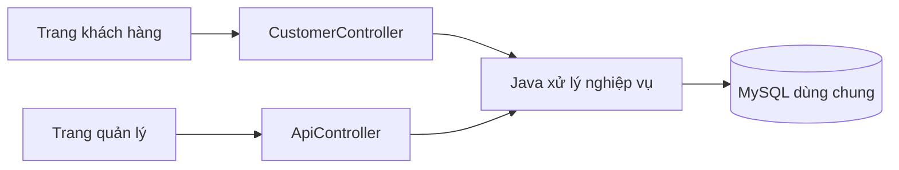

# Hai phía khách hàng và quản lý

## Mở ứng dụng

- `MO_KHACH_HANG.bat`: mở `http://127.0.0.1:8080/khach-hang/`.
- `MO_QUAN_LY.bat`: mở `http://127.0.0.1:8080/quan-ly/`.
- `DUNG_UNG_DUNG.bat`: dừng ứng dụng và MySQL riêng, giữ dữ liệu.

Nếu đổi cổng, file BAT tự đọc cổng đang chạy. Hai phía chạy trong cùng một ứng dụng Java và dùng chung MySQL. Không cần chạy hai server.

## Khách hàng sử dụng thế nào?

1. Mở phía khách hàng, chọn ngày để xem sân và giờ còn trống; chưa cần đăng nhập để xem.
2. Chọn **Đăng ký**, nhập họ tên, số điện thoại riêng, tên đăng nhập và mật khẩu. Đăng ký thành công tự đăng nhập.
3. Chọn một sân, một hoặc nhiều giờ liên tiếp trong cùng ngày, kiểm tra tổng tiền rồi xác nhận đặt.
4. Vào **Đơn của tôi** để xem mã đơn, giờ chơi, số tiền và trạng thái thanh toán. Đơn này đồng thời xuất hiện trong trang quản lý.
5. Có thể tự hủy đơn còn xác nhận, chưa thanh toán và chưa tới giờ bắt đầu đầu tiên. Hủy giữ lịch sử và trả các giờ về trống.
6. **Tài khoản** cho phép sửa thông tin liên hệ và đổi mật khẩu. Đổi mật khẩu sẽ đăng xuất các phiên khác.

## Quy tắc tài khoản

- **Tên đăng nhập:** không được để trống, tối đa 50 ký tự và không được trùng tài khoản đã có. Cho phép tiếng Việt và khoảng trắng ở giữa tên; hệ thống bỏ khoảng trắng ở hai đầu trước khi lưu hoặc đăng nhập. Không bắt buộc tối thiểu 3 ký tự và không giới hạn chỉ dùng chữ Latin.
- **Mật khẩu khi đăng ký hoặc đổi:** ít nhất 8 ký tự, tối đa 72 byte UTF-8; bắt buộc có ít nhất một chữ hoa Unicode, một chữ số Unicode và một ký tự thuộc nhóm dấu câu hoặc ký hiệu Unicode (ví dụ `!`, `@`, `#`). Khoảng trắng không tính là ký tự đặc biệt. Không bắt buộc có chữ thường. Nhập lại mật khẩu phải khớp.
- **Đăng nhập:** tài khoản đã có vẫn dùng mật khẩu hiện tại, không áp dụng lại quy tắc độ phức tạp mới. Chỉ mật khẩu tạo mới hoặc thay đổi mới phải thỏa đủ các điều kiện trên.

Giá tiền do máy chủ tính từ giá sân; trình duyệt không được tự gửi số tiền thu. Bản này thanh toán tại sân: quản lý ghi nhận tiền mặt/chuyển khoản sau khi thực nhận. Không có thanh toán trực tuyến hoặc hoàn tiền tự động.

Không tạo sẵn tài khoản khách giả. Hãy đăng ký một tài khoản mới để dùng thử. Tài khoản `admin / admin123` dùng cho phía quản lý. Khách hàng mẫu cũ là hồ sơ do nhân viên nhập, chưa có tài khoản đăng nhập; hệ thống không tự gán chúng cho người mới chỉ vì trùng số điện thoại. Nếu số đã tồn tại, dùng số khác để demo hoặc nhờ quản lý hỗ trợ.

Hai trang trong cùng trình duyệt dùng chung phiên đăng nhập. Để demo khách và quản lý đồng thời, mở một phía trong cửa sổ thường và phía còn lại trong cửa sổ ẩn danh hoặc trình duyệt khác.

## Mã nguồn nằm ở đâu?

```text
D:\BTL_DB\
  MO_KHACH_HANG.bat                   Mở phía khách
  MO_QUAN_LY.bat                      Mở phía quản lý
  src/main/resources/static/
    khach-hang/
      index.html                     Khung trang khách
      customer.css                   Giao diện khách
      customer.js                    Thao tác, gọi API khách
    index.html, app.css, app.js       Giao diện quản lý có sẵn
  src/main/java/vn/edu/pickleball/
    customer/
      CustomerController.java        API dành cho khách
      CustomerService.java           Lọc dữ liệu đúng chủ đơn, đặt và hủy
      CustomerAccounts.java          Đăng ký, hồ sơ, mật khẩu
      CustomerRequests.java          Dữ liệu đầu vào của khách
    AuthController.java              Đăng nhập/đăng ký/đăng xuất chung
    AuthFilter.java                  Kiểm tra quyền ADMIN hoặc CUSTOMER
    SessionAuth.java                 Phiên đăng nhập và CSRF
    PortalPages.java                 Đường dẫn hai trang
    CustomerSchema.java              Nhận biết và nâng cấp DB cũ
    ApiController.java               API quản lý
    BookingService.java              Nghiệp vụ sân và đặt sân dùng chung
  database/
    01_schema.sql                    Bảng, khóa và ràng buộc
    02_routines.sql                  Nghiệp vụ đặt/thu tiền/hủy của quản lý
    03_seed.sql                      Sân, giờ, hồ sơ khách mẫu
    04_queries.sql                   Truy vấn học tập
    05_customer_portal.sql           Nâng cấp tài khoản + hủy đơn của khách
    06_customer_account_rules.sql    Cho phép tên đăng nhập Unicode, 1–50 ký tự
```

## Vì sao hai phía cùng biết một đơn?



Khi khách đặt, Java lấy `customer_id` từ phiên đăng nhập, gọi procedure tạo đơn trong MySQL. Trang quản lý đọc chính bảng `bookings` và `booking_items` đó. Lịch được đọc lại khi tải trang/chuyển mục; không có WebSocket tự cập nhật liên tục.

## Thay đổi cơ sở dữ liệu

Vẫn là 7 bảng. Bảng `app_users` thêm:

- `role`: `ADMIN` hoặc `CUSTOMER`.
- `customer_id`: liên kết tới hồ sơ `customers` và duy nhất cho mỗi tài khoản khách.
- Ràng buộc: ADMIN không gắn hồ sơ khách; CUSTOMER bắt buộc có hồ sơ khách.

Tài khoản quản lý cũ giữ nguyên ID và mật khẩu, mặc định nhận quyền ADMIN. Migration không xóa dữ liệu và không tạo thêm đơn mẫu. Khi tự nhập SQL trên máy khác, chạy lần lượt 5 file `01`, `02`, `03`, `05`, `06`; `04` chỉ chứa truy vấn minh họa. File `06_customer_account_rules.sql` chạy sau `05` để bỏ ràng buộc tên đăng nhập tối thiểu 3 ký tự, cho phép 1–50 ký tự; không thay đổi mật khẩu hoặc số điện thoại đã có.

API quản lý chặn tài khoản khách ngay tại Java. API khách chỉ đọc/sửa đơn đúng `customer_id` trong phiên. Lịch trống công khai chỉ hiện trống/bận, không trả ID đơn hay thông tin khách khác. Password lưu dạng BCrypt, phiên là cookie HttpOnly và mọi thao tác ghi cần CSRF token.
